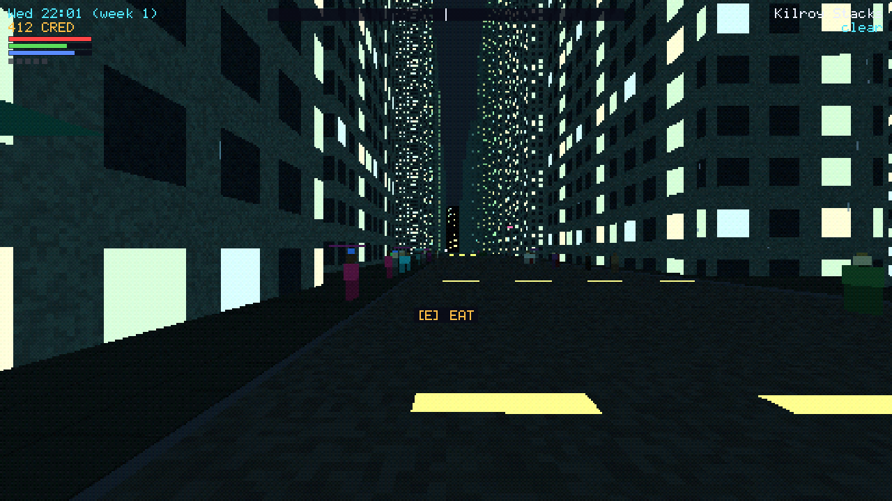

# Silverrock

> *The sun hasn't risen in forty years. Rent is due on Friday.*

A first-person cyberpunk RPG in a procedurally generated, permanently night-time city. You are a mercenary on the
bottom rung, paying rent with small jobs — until the black-ops division of one of the city's 5–10 megacorps puts you on
retainer, and your jobs become moves in the corporate chess game. Retro low-poly 3D, a living city, a separate 3D
Matrix that changes the real world, and an emergent story about corporations, politicians and gangs, each with its own
agenda.



**Status:** milestones M0–M5 implemented (2026-11-06), followed by a playability pass and a pass on the city's atmosphere (2026-11-07, see the
[playtest notes](docs/reviews/playtest-2026-11-07-after.md) and the
[visual review](docs/reviews/visuals-2026-11-07-after.md)). You wake up in your apartment, walk a generated city at night
among citizens, traffic and aerodynes, eat, sleep, pay (or miss) rent, move to a better place, ride the metro, buy
gadgets and cyberware, take jobs from fixers and play site jobs inside the building. With a cyberdeck you can jack in
(home rig, public booth, a building's port, wireless or a data spike): fly the Matrix grid, breach hosts, dodge or
fight ICE, steal paydata, plant backdoors, and loop cameras, unlock doors, turn turrets, kill the lights or black out
a district in the real world. Behind it all the megacorps, gangs, council and press play their own game: every job is
a step in someone's operation, elections and curfews change the streets, share prices move with your work, and a
patron's black-ops handler pulls you into a campaign with procedural story arcs and five endings. Manual checks on
Windows hardware and real phones are still open.

## Build and play

```bash
git clone --recurse-submodules https://github.com/stbange/silverrock.git
```

```bash
cmake --preset linux-gcc-debug && cmake --build --preset linux-gcc-debug
```

```bash
./build/linux-gcc-debug/silverrock
```

Controls: WASD move, mouse look, left click fire, J jack in/out, V Netsight, E interact (enter buildings, eat, sleep, shop, talk to fixers,
do and report jobs, take down guards from behind, ride the metro), Q active cyberware, T terminal (left/right switch tabs: home, news, market, Board, story; E in the home
terminal lists apartments), 1–4 quick slots (gadgets), Shift sprint, C crouch (crawl through vents, enter by the
service door), Space jump, Esc pause, F11 fullscreen. Gamepads and touch work too.

Web build (needs the Emscripten SDK):

```bash
emcmake cmake -S . -B build/web -G Ninja -DCMAKE_BUILD_TYPE=Release && cmake --build build/web --target silverrock
```

Then serve `build/web/` with any static web server and open `silverrock.html`.

## Tests

| Suite | Command |
|---|---|
| Unit tests (122 tests) | `./build/linux-gcc-debug/sr_tests` |
| Platform and GL tests (needs a display or Xvfb) | `xvfb-run -a ./build/linux-gcc-debug/sr_platform_tests` |
| Headless game scenarios | `ctest --test-dir build/linux-gcc-debug -R game_` |
| World sweep / balance report | `./build/linux-gcc-debug/sr_headless --sweep 2000` / `--balance 20` |
| Browser end-to-end | `NODE_PATH=$(npm root -g) node tests/web/run.mjs build/web` |
| Coverage gate | `cmake --preset linux-coverage && cmake --build --preset linux-coverage`, run the suites, then `python3 tools/coverage_gate.py build/linux-coverage` |
| Quality-gate self-tests | `python3 tests/tools/test_tools.py` |
| Spec traceability | `python3 tools/spectrace.py` |

## Concept

| Document | Contents |
|---|---|
| [Game design](docs/concept/01-game-design.md) | Vision, pillars, setting, player, core loops, procedural city, living city, factions and the corporate game, story, jobs, progression, economy, combat, weapons and gadgets, the Matrix, art direction, controls |
| [Technical design](docs/concept/02-technical-design.md) | C17 / SDL3 / OpenGL architecture, determinism, world generation, simulation, retro renderer, input and touch, persistence, platforms, performance budgets, testing strategy (≥ 95 % coverage, automated game tests), CI |
| [Roadmap](docs/concept/03-roadmap.md) | Milestones M0–M7, first playable slice, risks, open questions |
| [Soundtrack](docs/concept/04-soundtrack.md) | *Songs for a City Without a Sun*: the musical vision (three layers, four leitmotifs) and 51 ambient instrumental tracks with ready-to-paste prompts for AI music generators |

## Technology

- **C17**, **SDL3**, **OpenGL 3.3 Core** (desktop) and **OpenGL ES 3.0 / WebGL 2** (web)
- Targets: **Windows**, **Linux**, **Web** via Emscripten — mobile browsers switch to touch controls automatically
- Unit tests with ≥ 95 % line coverage, headless scenario tests, autoplayer bots, input replays, visual regression,
  browser end-to-end tests
- Spec-driven development with [OpenSpec](https://github.com/Fission-AI/OpenSpec)

## Specifications (OpenSpec)

Each roadmap milestone is an OpenSpec change in [`openspec/changes/`](openspec/changes) with a proposal, design, tasks
and spec deltas (22 capabilities, 206 requirements, 310 scenarios). Implemented changes get archived into
[`openspec/specs/`](openspec/specs).

| Milestone | Change | Capabilities |
|---|---|---|
| M0 Foundation | [`add-engine-foundation`](openspec/changes/add-engine-foundation) | platform-runtime, input-controls, quality-gates |
| M1 Procedural City | [`add-procedural-city`](openspec/changes/add-procedural-city) | city-generation, faction-roster, world-environment, retro-rendering |
| M2 Living City | [`add-living-city`](openspec/changes/add-living-city) | population-simulation, player-life, game-persistence |
| M3 Mercenary Work | [`add-mercenary-work`](openspec/changes/add-mercenary-work) | job-system, combat, equipment, character-progression, law-and-heat |
| M4 The Matrix | [`add-matrix`](openspec/changes/add-matrix) | matrix-navigation, matrix-world-link |
| M5 Corporate Chess | [`add-corporate-chess`](openspec/changes/add-corporate-chess) | faction-simulation, city-politics, corporate-market, news-media, story-campaign |
| Playability pass | [`improve-playability`](openspec/changes/improve-playability) | job-system, faction-simulation, character-progression, player-life, law-and-heat, story-campaign, news-media |
| City atmosphere | [`improve-city-atmosphere`](openspec/changes/improve-city-atmosphere) | retro-rendering, city-generation, world-environment, news-media, story-campaign |
| Animation (proposed) | [`improve-animation`](openspec/changes/improve-animation) | retro-rendering, population-simulation, combat, player-life |

Validate the specs:

```bash
npx @fission-ai/openspec@1.16.0 validate --all --strict
```

List the changes and their task progress:

```bash
npx @fission-ai/openspec@1.16.0 list
```
