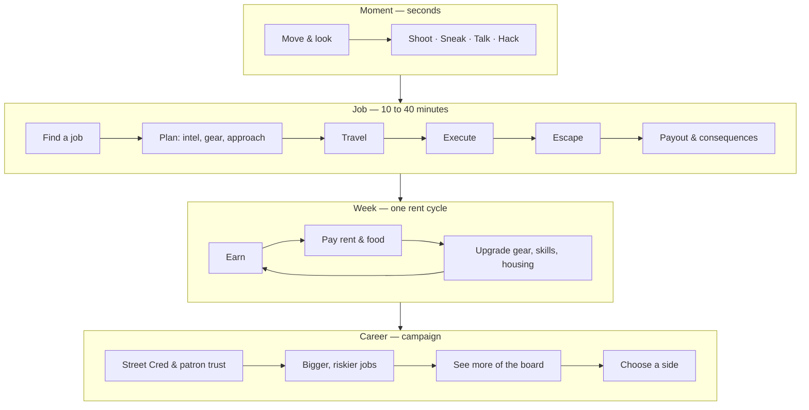
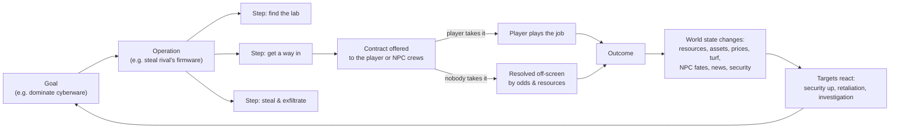

# Silverrock — Game Design Concept

> *Nobody has seen the sun in forty years. Rent is due on Friday.*

| | |
|---|---|
| **Working title** | Silverrock |
| **Genre** | First-person cyberpunk RPG / immersive sim in a procedurally generated, living city |
| **Look** | Retro low-poly 3D (late-90s style), low-resolution rendering, neon-lit, rain-soaked, near-permanent night |
| **Platforms** | Windows, Linux, Web (desktop browsers, and mobile browsers with touch controls) |
| **Technology** | C17, SDL3, OpenGL 3.3 Core / OpenGL ES 3.0 (WebGL 2), Emscripten |
| **Players** | Single-player |
| **Session shape** | 20–60 min sessions (a few jobs); campaign 25–40 h; open-ended sandbox afterwards |
| **Replayability** | Every seed is a new city with new megacorps, gangs, politicians and story arcs |
| **Process** | Spec-driven development (OpenSpec), ≥ 95 % unit-test line coverage, automated game tests |
| **Status** | Concept v0.1 — 2026-11-04 |

Companion documents: [Technical design](02-technical-design.md) · [Roadmap, risks & open questions](03-roadmap.md) · Specs: [`openspec/`](../../openspec)

---

## 1. Vision

You are a nobody with a cheap pistol, a burner cyberdeck and a 14 m² apartment in a mega-block. Above you,
five to ten megacorporations play chess with the city. Politicians, gangs, cops, unions and media are their
pieces — and so are you.

Silverrock generates that city from a seed: its districts, streets and towers, its corporations and their black-ops
divisions, its gangs, its politicians and their secrets. Then it lets the city run. Citizens commute to the night
shift, gangs fight over corners, councillors take bribes, and the corporations move their pieces whether the player
is watching or not.

The player starts at the bottom: rent is due in seven days and the fridge is empty. Small jobs pay for noodles and
the next week. One of those jobs is a test, and the black-ops division of one of the megacorps puts you on a
deniable retainer. From then on, every courier run, data theft or "accident" is a move in a game you can only see a
few squares of. Get better, see more of the board, take bigger risks — and eventually decide which side you're on
when the game ends.

Three things make Silverrock special:

1. **A new city every time that still feels designed.** Procedural generation with strong rules for readability,
   landmarks and district identity.
2. **Small jobs, big consequences.** A strategic faction simulation turns the corporate game into contracts. Every
   job the player takes (or turns down) changes that game.
3. **Two worlds, one job.** Meatspace and the Matrix are two connected 3D spaces. What you do in one changes the
   other: open a door, loop a camera, erase a warrant, black out a district.

## 2. Design pillars

Every feature is checked against these five pillars.

| # | Pillar | What it means | Question to ask of each feature |
|---|---|---|---|
| 1 | **The city doesn't need you** | Factions, citizens and the economy run on their own. The player is one actor among thousands. | Does this still happen when the player isn't looking? |
| 2 | **A pawn on the board** | Small jobs, partial information, real consequences. The big picture is earned through intel. | Does this connect a small action to the big game? |
| 3 | **Rent before glory** | Progress shows up in daily life: better food, a better apartment, better gear, better jobs. | Does this make the player's growth tangible? |
| 4 | **Two worlds, one job** | Missions get easier or different when the Matrix and meatspace are combined. | Can the other world solve or change this? |
| 5 | **Retro, but readable** | Low-poly and pixelated, yet every district, faction and person can be recognised at a glance. | Can a player tell who or where this is within a second? |

## 3. Setting — life under the Pall

- Forty years ago a geoengineering programme meant to cool an overheating planet overshot. A persistent
  stratospheric aerosol layer — **the Pall** — now covers the region. For a few grey hours around noon a dim half-light seeps through, and at
  dawn and dusk a red smear shows low under the clouds, but nobody has seen the sun itself. The rest of the time
  the sky is a low, heavy ceiling that glows with the reflected light of the city.
- The corporations that built the Pall maintain it, and sell back what it took: UV booths, vitamin supplements,
  synthfood grown under lamps, "daylight apartments" with simulated sun panels. Light is a commodity, and neon is its
  cheapest form.
- The city still keeps time — clocks, shifts, opening hours — but it is **nearly always night**: about 19 of
  every 24 hours. People talk about "first shift" instead of morning, and "the grey" for the short dim day. The world clock drives routines, not the sky.
- Each seed creates a **city-state** (for example *Port Vesper*, *New Kessling* or *Saint Orrin*) with its own
  coastline, districts, corporations, gangs and government. Officially, a mayor and council rule it. In practice, it
  belongs to whoever is winning the corporate game this quarter.
- **Tone:** noir, sardonic, humane. High tech, low life; small people trying to get by. Humour lives in signage,
  adverts and NPC chatter. Violence is present but not gratuitous, and non-lethal play is fully supported.

Inspirations for tone and systems (not content): the Sprawl novels, Blade Runner, tabletop cyberpunk RPGs,
immersive sims, procedural RPGs, and the look of late-90s low-poly 3D.

## 4. The player

### 4.1 Who you are

A freelance mercenary — a *runner*, *contractor*, *asset*. Deniable labour for whoever pays. You have no corporate
citizenship, no insurance (yet) and no friends in high places (yet).

### 4.2 Character creation

- **Name, pronouns and appearance.** Built from the same modular generator as the NPCs, with a randomise button.
- **Background.** Sets starting attributes, two trained skills, one starting contact, starting kit and cash:

| Background | Attribute bias | Trained skills | Starting contact | Kit |
|---|---|---|---|---|
| Street Kid | REFLEX, COOL | Pistols, Streetwise | a gang lieutenant | cheap pistol, switchblade |
| Ex-Corp Wageslave | MIND, COOL | Persuasion, Electronics | a disgruntled middle manager | suit, expired corp ID, mid-range deck |
| Ex-Military | BODY, REFLEX | Long Guns, Athletics | an arms dealer | service pistol, armoured vest |
| Dropout Netrunner | MIND, TECH | Netrunning, Electronics | a hacker-collective member | good deck, three programs |
| Back-Alley Medic | TECH, MIND | Medicine, Engineering | a ripperdoc | medkits, stims, scalpel |

- **City options.** Seed (random, or typed as a shareable code such as `VESPER-7Q4K-2NMA`), city size (Medium ≈ 3 × 3 km,
  Large ≈ 4 × 4 km), number of megacorps (random 5–10, or fixed), difficulty, and an optional *Hardcore* mode
  (permadeath).

### 4.3 Day one (example)

It's 21:40 on a Monday. You wake up in unit 33-118 of the Hollis Stack mega-block. Rain drums on the window, and the
holo-ad across the street sells Verdance "SunBread". Your terminal shows a message from the landlord (rent: 300 cred,
due Sunday 23:59) and three gigs from Mama Kestrel, the fixer who runs the noodle bar downstairs. You have 412 cred
and two food packs.

You eat, take the elevator down, buy a metro ticket and deliver a sealed case to a clinic in the Strip. A Rust Dogs
member tries to take it from you on the way. You talk your way out (Streetwise check), or shoot your way out, or just
run. The clinic pays 120 cred. Two days and four gigs later, a stranger calls you by name. They know about the case.
They know the clinic. They work for the **Null Office** — the black-ops division of Hexis Netware — and they have a
small job for you.

## 5. Core loops



**Time scale.** By default, 1 real minute is 20 in-game minutes (configurable). An in-game day lasts about 72 real
minutes. Sleeping, metro rides and waiting skip time. A rent week takes roughly 5–6 hours of play.

## 6. The procedural city

### 6.1 How a city is made

A seed and a generator version fully determine the city. The same seed gives the same city on every platform.
Generation runs in stages:

1. **Geography.** City boundary, coastline or river, elevation terraces, a polluted bay.
2. **Districts.** 8–14 districts placed by weighted Voronoi with relaxation. Types are assigned under rules (the
   Spire near the centre, Docks on the coast, Industrial next to Docks, Campus at the edge, and so on).
3. **Transport skeleton.** Arterial roads, elevated highways (whose shadows form the Undercity), metro lines
   connecting all districts, and skyways between towers in rich districts.
4. **Blocks and lots.** Polygon subdivision, with a style per district: strict grid in the Spire, organic in the
   Old Quarter, chaotic in the Sump.
5. **Buildings.** Shape grammars per district and wealth level: footprint, floors, setbacks, rooftop props, facade
   modules and neon signs. Landmarks are special: megacorp HQ towers, City Hall, the Pall Control Spire.
6. **Places of interest.** Shops, bars, clinics, ripperdocs, capsule hotels, fixer haunts, gang hideouts, corporate
   facilities, police precincts and public Matrix jack-in booths, weighted by district.
7. **Factions.** Megacorps, gangs, government and minor groups are generated and given HQs, facilities and turf
   (see §8).
8. **Population.** Persistent notable citizens get homes, workplaces and schedules (see §7).
9. **Matrix mirror.** Every networked building gets a host; the global grid mirrors the city layout (see §15).
10. **Validation.** Invariants are checked: everything is reachable, every district has a metro station, the
    player's home has food, a fixer and a clinic nearby, every corp has an HQ and at least three facilities. A failed
    check deterministically re-rolls that stage — the player never sees a broken city.

Fine detail (building geometry, interiors, props) is generated on demand in 64 m chunks around the player and
cached. Player-caused changes are stored as deltas on top of the seed.

### 6.2 District types

| District | Look & light | Who's there | Typical opportunities | Law & security |
|---|---|---|---|---|
| **Corporate Spire** | glass towers, cold white & cyan, giant holo-logos | executives, guards, drones | infiltration, data theft, extraction | corporate security, very fast response |
| **Civic Center** | brutalist concrete, white & police-blue strobes | officials, police, protesters | politics, records, evidence | police HQ, fast response |
| **Commercial Market** | dense signage, every colour at once | shoppers, vendors, pickpockets | courier runs, theft, protection | regular patrols |
| **Entertainment Strip** | magenta & violet, holo-dancers | clubbers, dealers, bouncers | info brokering, blackmail, bodyguard work | lax and bribable |
| **Residential Megablocks** (start) | teal & pink, stacked balconies, laundry lines | commuting workers, families | neighbour favours, debt collection | sparse |
| **Old Quarter** | warm red lanterns & gold, pre-Pall brick | old families, temples, fixers | smuggling, heirlooms, favours | community watch |
| **Industrial Zone** | sodium orange, smoke stacks | shift workers, union organisers | sabotage, theft, strike-breaking (or not) | corp security at plants |
| **Docks & Port** | blue & amber floodlights, container canyons | dockers, smugglers | smuggling, hijacks, inspections | corrupt port authority |
| **Research Campus** | sterile green & white, walls and lawns under UV lamps | scientists, security | prototype theft, defector extraction | corporate, extreme |
| **Undercity / Sump** | toxic green & red, beneath the highways | the forgotten, gangs, black clinics | gang jobs, hideouts, cheap chrome | none |
| **Barrens / Edge** | darkness, trash fires, junk | scavengers, nomads | salvage, hidden labs | none |

Every city has exactly one Spire and one Civic Center, and at least one Residential, Commercial, Industrial,
Entertainment and Undercity district. The others are optional.

### 6.3 Vertical layers

- **Undercity (−1):** under elevated highways and platforms. Dark, wet, dangerous, full of shortcuts.
- **Street (0):** the main public layer.
- **Skyways (+1):** pedestrian bridges and plazas between towers in rich districts. Cleaner and watched.
- **Rooftops (+2):** reachable by stairs, elevators, fire escapes and grapple points. Snipers, drones, back doors.
- **Interiors:** generated on entry for enterable buildings. Most buildings are facades. Every place of interest and
  every mission site is enterable.

### 6.4 Buildings and interiors

- Facades are assembled from modules (window bands, balconies, AC units, signage, pipes) with district-specific
  styles and wealth levels. Lit-window patterns follow the residents' simulated schedules.
- **Mission-capable interiors** are generated from room graphs by building type (office floor, lab, warehouse, club,
  clinic, apartment block, data centre). Guaranteed properties:
  - at least two distinct entry routes (for example front door, service door, vent, roof, window, sewer);
  - a security chain (cameras → security room or host node; locks → keycard holder or host node);
  - loot and intel placed according to the building's owner and purpose.
- **The player's apartment** and later housing are hand-designed templates with procedural decoration.

### 6.5 Names, signage and adverts

- Names come from several syllable and morpheme tables with different sound palettes, so the city feels diverse
  without leaning on real-world stereotypes. All generated names are checked against a blocklist of real companies,
  brands and public figures.
- Shops get template names ("Chrome & Bone Clinic", "Lucky Seven Noodle", "Kessler's Guns & Gifts") and an icon sign
  (noodle bowl, pill, gun, chip, bed), so their function reads from across the street.
- Billboards and holo-ads advertise products from the generated megacorps. When a corp suffers a scandal, its ads
  get vandalised; when it wins, its ads multiply.

### 6.6 Environment

- **Long nights, short grey days.** Night lasts about 19 hours. Dawn comes around 10:00, a dark overcast day
  ("the grey") lasts until about 14:00, and dusk ends by 15:00. Dawns and dusks show a red-orange band low under
  the clouds; the sun itself is never seen (with one exception, see §9.4). Even at noon, the neon is brighter than
  the sky.
- **The Pall** hangs as a low, heavy cloud deck that swallows the tallest towers. At night it glows with the colours
  of the districts below; by day it is dark slate grey.
- **Rain and fog almost always.** It rains about 90 % of the time and there is always some fog. The player sees one
  or two blocks; beyond that, only neon halos glow through the murk: a corporate logo, a billboard, a red beacon.
- **Weather** changes deterministically over time: overcast, drizzle, downpour, fog, smog alert, acid-rain advisory.
  Weather affects visibility, sound, NPC behaviour (umbrellas, sheltering under awnings, empty streets) and stealth.

### 6.7 Example city — seed `VESPER-7Q4K-2NMA`

*Port Vesper*, Medium size, 11 districts, 7 megacorps:

| Megacorp | Sector | Doctrine | Black-ops division |
|---|---|---|---|
| Aurelian Dynamics | Arms & Security | Fortress | Grey Ledger |
| Kurogane-Halloway | Cyberware | Shark | Division Nine |
| Verdance Biosystems | Biotech & Synthfood | Spider | The Gardeners |
| Solace Media Group | Media & Entertainment | Prophet | The Quiet Room |
| Hexis Netware | AI & Netware | Spider | Null Office |
| Corvid Mutual | Finance & Insurance | Vulture | Actuarial Services |
| Umbra Atmospherics | Energy (maintains the Pall) | Fortress | Eclipse Group |

Gangs: **Static Saints** (techno-cult netrunners, Undercity), **Rust Dogs** (salvage crew with heavy chrome, Docks),
**Velvet Knives** (club-scene syndicate, Strip), **Hollow Choir** (cyber-ascetic cult, Barrens).
The mayor is backed by Corvid Mutual. Three of the seven council seats are up for election in week 8.

## 7. A living city

### 7.1 Who lives here

- **Notable citizens** (up to ~3,000 persistent records per city): named people with a home, a workplace, a
  schedule, a faction, traits, relationships and a memory of the player. Vendors, bartenders, landlords, guards,
  executives, gang members, cops, councillors, fixers, neighbours.
- **Ambient citizens:** the crowd. Generated per block from district and time-of-day tables with deterministic
  seeds, so the same corner has the same kind of crowd at the same hour. An ambient citizen becomes notable as soon
  as the player interacts meaningfully with them (talks, trades, hires, robs, hurts or saves them).
- **Statistical population:** the rest of the millions, simulated as flows and densities per block and hour. It
  drives crowd size, traffic and economic demand.

### 7.2 Routines and shifts

The city runs on three shifts. People commute (on foot, by metro, by auto-cab), work, eat, shop, party and sleep.
Rush hours happen at shift changes. The Strip peaks from 22:00 to 04:00, the Spire at shift changes, the Market in
the "evening". Shops and services have opening hours. Lit windows follow who is home.

### 7.3 Level-of-detail simulation

| Tier | Range | What is simulated |
|---|---|---|
| **Near** | ~0–80 m, in view or audible | full agents: steering, animation, perception, dialogue, combat |
| **Mid** | same and neighbouring chunks | simplified agents moving along the navigation graph; no perception; cheap schedule logic |
| **Far** | rest of city | schedules resolved analytically (where should this person be now?); crowd densities per block |

Transitions are invisible: an NPC who walks out of view and comes back later is where their schedule says they
should be, not where they vanished.

### 7.4 Reactions

Citizens perceive gunfire, bodies, fights, crimes and weird behaviour. Depending on their traits and the district
they flee, take cover, film it, gawk, call the police (or don't — nobody calls in the Sump) or join in. Rain sends
people under awnings and opens umbrellas. Gang members hassle outsiders on their turf. Guards check IDs at corporate
entrances.

### 7.5 Services and venues

Food stalls, noodle bars, groceries, bars and clubs, clinics, ripperdocs, gun shops, electronics shops, clothing
stores, fences, capsule hotels, UV booths, metro stations, public jack-in booths, fixer haunts. All staffed by
notable citizens who keep their own hours.

### 7.6 Traffic and transport

Ground traffic on the road graph, aerodynes in sky lanes (mostly visual; corporate ones land at pads), metro trains
on schedules, and auto-cabs. The player travels on foot, by metro (cheap, station to station) or by cab (more
expensive, door to door). There is no player driving in the first version.

### 7.7 City events

Generated by the simulation, not scripted: gang skirmishes, police raids, protests and strikes, corporate lockdowns
after an attack, district blackouts, executive motorcades, cyberpsycho incidents (with bounties), market crashes,
street festivals, election rallies.

### 7.8 Rumours and news

Every significant world event becomes a news item, spun by whichever outlet reports it (corp-owned outlets protect
their owners). News shows on terminals, billboards and radios. NPCs pass on rumours in barks and conversations —
including about things the player did: *"Heard someone cracked the Kurogane clinic last night. Inside job, they say."*

## 8. Factions and the corporate chess game

### 8.1 Megacorps (5–10 per city)

Each megacorp is generated with:

- **Identity:** name (from morpheme grammars, checked against the blocklist), primary and secondary sector, a
  colour pair, a procedural logo (shape, glyph, frame), an HQ tower silhouette, a security uniform style and a
  product line (its weapons and cyberware look like *its* brand).
- **Doctrine** (how it plays the game):

| Doctrine | Plays like | Preferred moves |
|---|---|---|
| **Shark** | aggressive expansion | hostile takeovers, sabotage, poaching talent |
| **Fortress** | defensive, militarised | security build-up, retaliation, contracts for force |
| **Spider** | intelligence and leverage | data theft, blackmail, moles, proxies |
| **Prophet** | public image and ideology | media campaigns, politics, scandals |
| **Vulture** | opportunistic | buying weakened assets, insurance plays, short-selling rivals |

- **Resources:** Capital, Influence (political), Force (security and military), Intel, NetSec (Matrix defence),
  Public Image.
- **Assets:** HQ, facilities (labs, plants, warehouses, data centres, stores, clinics), subsidiaries, owned
  politicians, funded gangs, media outlets.
- **A black-ops division** with a codename, a doctrine and a handler NPC (the player's eventual patron is one of
  these).
- **Relationships** with every other faction (rival, competitor, partner, proxy).

Sectors: Arms & Security, Cyberware, Biotech & Synthfood, Media & Entertainment, AI & Netware, Finance &
Insurance, Energy (Pall maintenance), Logistics & Transport, Construction & Real Estate (one of them might own
your mega-block), Orbital & Aerospace. Every city has at least one corp that makes weapons and one that makes
cyberware.

### 8.2 Other players on the board

| Group | Generated as | Agenda examples |
|---|---|---|
| **City government** | mayor + 5–9 councillors, each with a political lean, corruption level and patrons | win elections, pass or block policies (police budget, curfews, zoning, corp licences) |
| **Police** | city department with precincts; the contract may be privatised to a corp | crack down, take bribes, protect patrons |
| **Gangs** (3–6) | name, theme, colours, a signature visual marker, turf, business, corporate ties | expand turf, run rackets, settle scores, serve a corp as proxy |
| **Fixers** (≥ 1 per district) | individual brokers with reliability and networks | profit, protect their reputation |
| **Media outlets** (≥ 2) | owned by corps or independent | ratings, protect owners, expose rivals |
| **Hacker collective** | anarchic netrunners | free information, embarrass corps |
| **Workers' union** | dockers or factory workers | wages, safety, strikes |
| **Church of the Deep Signal** | AI-worshipping cult | recruit, protect "the Signal" |
| **The Ghost** (hidden) | a rogue AI in the deep Matrix | unknown — late-game mystery |

### 8.3 The agenda simulation

The strategic layer ticks every 6 in-game hours. Each faction evaluates its goals against its doctrine and
resources and launches or advances **operations**. Operations are made of **steps**; each step needs work done
in the city. That work becomes **contracts**.



- Contracts reach the player through channels that fit the client: the patron's handler, fixers, gang contacts,
  or public job boards. Jobs the player turns down are attempted by rival NPC crews, so declining is also a move.
- **Attribution:** factions only blame who they can identify — witnesses, camera footage, Matrix traces,
  evidence left behind. The player can wipe traces, or plant evidence to frame someone else.
- **Bounded:** no corp is destroyed before the endgame, and resources are capped, so the board stays interesting
  for the whole campaign. Small gangs can be wiped out and replaced by new ones.

### 8.4 Consequences you can see

Corp security patrols thicken around facilities after an attack. Shops close when a gang loses its turf and reopen
under new "management". Graffiti changes colour. Prices of synthfood rise after a Verdance plant is sabotaged.
A councillor resigns after a leaked file, and the curfew policy flips at the next vote. Billboards switch from one
corp's adverts to another's.

### 8.5 The Board

An intel screen on the player's terminal. It starts nearly empty: a few faction logos and the jobs you did.
Intel (stolen files, overheard conversations, bought information, deduction from job briefings) fills it in: who
hired whom, which operation a job belonged to, who owns which councillor, which gang a corp funds. The Board is how
the player "sees more of the chessboard" as they rise.

### 8.6 Markets

Each corp has a share price driven by its resources and by news. The player can buy and sell shares. Knowing that
tomorrow's job will sabotage a rival's launch is, of course, an opportunity. It is also insider trading, and the
Finance & Insurance corps watch for it.

## 9. Story and campaign

### 9.1 Structure

The campaign has an authored spine filled with procedural content. Pacing depends on reputation and world events,
not a fixed script.

| Part | Player rank | What happens |
|---|---|---|
| **Prologue — "Rent Is Due"** | Nobody | Week one. Street gigs, the apartment, the landlord, the first fixer. One gig is secretly a test. |
| **Act I — "Pawn"** | Pawn → Runner | The patron's black-ops division puts you on a deniable retainer: small jobs, low trust, probation. You still freelance to make rent. You learn the board. |
| **Act II — "Knight"** | Runner → Knight | Real operations for the patron. Rival corps notice you and make counter-offers. Procedural arcs intensify. Double-dealing becomes possible — and dangerous. |
| **Act III — "Promotion"** | Knight → Legend | A checkmate scenario begins. You learn what the patron really planned for its pawn. You choose a side. |

The patron corp is chosen at new-game time from the generated corps (random by default, selectable in advanced
options). It is always one of the 5–10 megacorps of that city.

### 9.2 The patron and the handler

The handler is an authored role with a generated identity. They meet the player at generated locations
(a rooftop, a capsule hotel, a noodle bar) and talk through the terminal. **Trust** (0–100) grows with successful,
clean, deniable work and drops with failures, exposure and jobs that hurt the patron. Working for rivals is allowed
and lucrative, but if the patron finds out (see attribution) trust collapses: penance jobs at best, hit squads at
worst.

### 9.3 Procedural story arcs

Arcs are templates instantiated with the current factions. Each arc has 3–6 beats; each beat is a job or event;
outcomes branch the next beat. One to three arcs run at the same time.

| Arc template | Shape |
|---|---|
| **Hostile Takeover** | dig up financials → discredit the CEO → sabotage a launch → turn a board member |
| **Prototype War** | locate the lab → steal research → extract the lead scientist → destroy what's left |
| **The Election** | dig up dirt → protect or disrupt a rally → tamper with the vote host → handle the fallout |
| **Proxy War** | arm a gang → hit a rival gang's supply → defend turf → decide who pays for it |
| **The Defector** | first contact → safehouse → extraction → was it a trap? |
| **Shortage** | sabotage supply → hoard → profit → a riot nobody planned |
| **Mole Hunt** | the patron suspects a leak — maybe you. Find the mole before they decide it's you. |
| **Scandal** | leaked file → bury or broadcast → reprisals |

### 9.4 Endgame and endings

Act III starts when one corp approaches dominance (a share of total resources) or when Act II has run long enough.
A checkmate scenario is chosen to fit the board:

- **Hostile Merger** — two corps attempt to become one.
- **Coup at City Hall** — a corp moves to own the government outright.
- **The Pall Protocol** — the energy corp plans to tighten the Pall (and its grip); someone else wants it gone.
- **Ghost in the Grid** — the rogue AI makes its move.

Five endings, depending on the scenario and the player's choices:

| Ending | Outline |
|---|---|
| **Loyal** | Your patron wins. You get a corner office in the shadows — and a leash. |
| **Defector** | You flip at the decisive moment. A new patron, a new target on your back. |
| **Burn the Board** | You leak everything through the Matrix and the media. Chaos; no one wins; the street remembers. |
| **Kingmaker** | You play everyone and walk away as the fixer everyone needs. |
| **Sunrise** | You bring down the Pall. The only time in the game the clouds break, the rain stops and the sun is seen over the city. |

After the ending the player can keep playing the sandbox in the changed city.

### 9.5 Authored cast

A small set of authored roles with generated identities and authored dialogue templates: the landlord, the first
fixer (Mama Kestrel in the example), a neighbour, the handler, a rival runner, a journalist, and the Ghost. The
story never soft-locks: if a critical character dies, the role passes to a successor.

### 9.6 Example arc — "The Firmware War" (Hexis vs. Kurogane-Halloway)

1. **Gig (Prologue).** Courier a "medical sample" across the Strip. It's a Kurogane prototype neural chip that Hexis
   had stolen. This is the test.
2. **Contract (Act I).** Steal a Kurogane ripperdoc's client list in a Matrix run on the clinic's host.
3. **Run (Act I).** Plant a backdoor in a Kurogane warehouse's security host so Hexis can watch shipments.
4. **Operation (Act II).** Extract a Kurogane engineer who wants to defect.
5. **The world reacts.** Kurogane's share price drops 12 %. News: "Clinic data breach exposes 4,000 patients".
   Kurogane-funded Hollow Choir cultists attack Hexis stores in the Strip. Kurogane cyberware prices rise 15 %.
   Security around Kurogane facilities doubles.
6. **The twist.** Files from step 2 hint that the engineer is a plant. If the player found and read them, they can
   warn the handler (trust up), sell the knowledge to Kurogane (betrayal, big payout), or let it play out.

## 10. Jobs

### 10.1 Anatomy of a job

Client · target · objective · location(s) · constraints (deadline, no kills, no alarms, item intact, no witnesses)
· known intel · pay (upfront and on completion) · bonus objectives · risk tier · expected Heat · faction
consequences.

### 10.2 Sources

Public job boards (terminal), fixers in their haunts, the patron's handler, faction contacts, people you helped,
and opportunities created by events (a bounty on a cyberpsycho, a crashed delivery drone).

### 10.3 Tiers

| Tier | Name | Pay (cred) | Unlocked at | Examples |
|---|---|---|---|---|
| T0 | Gig | 40–200 | Nobody | courier, find a lost item, collect a small debt, deliver a message |
| T1 | Contract | 200–800 | Pawn | petty theft, bodyguard a dealer, photograph a meeting, plant a bug |
| T2 | Run | 800–3,000 | Runner | data theft, sabotage, gang hideout raid, small extraction |
| T3 | Operation | 3,000–12,000 | Operator | facility infiltration, prototype theft, election tampering |
| T4 | Black Op | 10,000–50,000 | Knight + patron trust | executive extraction, HQ penetration, district blackout |

Higher tiers also need matching skills to be realistic. The game shows a risk rating based on the player's build
and gear.

### 10.4 Objective types

Deliver · fetch or steal an item · steal data (Matrix) · plant an item, bug or evidence · sabotage a device ·
extract a person · escort or bodyguard · neutralise a target (lethal or not) · intimidate or collect · investigate
or find a person · surveil or photograph · defend a location · clear a hideout · pure Matrix runs.

### 10.5 Four approaches

Every job can be solved in at least two of four ways, and the generator checks this:

- **Ghost** — stealth, darkness, vents, rooftops, disguises.
- **Face** — talking, bribing, social engineering, holo-masks, forged IDs.
- **Runner** — the Matrix: doors, cameras, turrets, records.
- **Hammer** — overwhelming force.

### 10.6 Failure

Failing a job is never game over. Missed deadlines, blown cover or a dead package cost reputation, client standing
and possibly Heat, and the world moves on (a rival crew might finish the job).

## 11. Character progression

### 11.1 Attributes (1–10)

| Attribute | Governs |
|---|---|
| **BODY** | health, carry weight, melee damage, intimidation, cyberware capacity (part) |
| **REFLEX** | aim stability, movement speed, dodge, reload speed |
| **TECH** | gadgets, crafting, devices, cyberware capacity (part) |
| **MIND** | netrunning, perception, intel, hacking speed |
| **COOL** | stealth, social skills, composure under fire, resisting interrogation |

### 11.2 Skills (ranks 0–20, improved by use)

| Skill | Attribute | Improved by |
|---|---|---|
| Pistols | REFLEX | hitting with handguns |
| Long Guns | REFLEX | SMGs, shotguns, rifles |
| Heavy Weapons | BODY | coilguns, launchers, arc projectors |
| Melee | BODY | blades, blunt weapons, unarmed |
| Athletics | BODY | sprinting, climbing, jumping, carrying bodies |
| Stealth | COOL | moving unseen, takedowns |
| Netrunning | MIND | Matrix actions, breaches, ICE fights |
| Electronics | TECH | bypassing panels, drones, gadgets |
| Engineering | TECH | crafting, weapon mods, repairs |
| Medicine | TECH | healing, stims, cyberware maintenance |
| Persuasion | COOL | negotiating, lying, bribing, intimidating |
| Streetwise | COOL | fences, prices, rumours, gang relations |

### 11.3 Levels and perks

Job XP raises the character level (cap 50). Every level grants a perk point; every third level grants an attribute
point. Each skill has a perk tree unlocked at ranks 5, 10, 15 and 20 (for example *Double Tap*, *Ghost Step*,
*ICE Breaker*, *Haggler*, *Field Surgeon*). Respecs are possible at a clinic ("neural reconditioning") for a price.

### 11.4 Street Cred

Global reputation (0–100) in six tiers: **Nobody, Pawn, Runner, Operator, Knight, Legend**. It unlocks job tiers,
changes how NPCs react, and opens doors (and invitations).

### 11.5 Standing and trust

- **Faction standing** (−100…+100: Hostile, Unfriendly, Neutral, Friendly, Trusted) per faction. It changes only
  when a faction attributes an action to the player.
- **Patron trust** (0–100), see §9.2.

### 11.6 Cyberware

Installed at ripperdocs, in slots, limited by **neural capacity** (from BODY and TECH). Going over capacity causes
glitches (aim jitter, HUD noise, random shutdowns). Quality grades: street, standard, military, prototype. Cheap
chrome can malfunction. Corp-made chrome may contain a manufacturer backdoor that corp netrunners can use against
you — unless a ripperdoc jailbreaks it.

## 12. Survival and economy

### 12.1 Needs

- **Health** — damage, healing, clinics.
- **Hunger** — drops over time (a full meter lasts ~36 in-game hours). Low hunger reduces stamina regeneration;
  starving slowly drains health, but never below 25 %.
- **Fatigue** — rises over time and with stims. High fatigue causes aim sway and slower hacking. Sleep fixes it.

### 12.2 Money

One currency: **cred**. Prices vary by district and react to the simulation.

- **Income:** jobs, selling loot to fences, selling paydata, bounties, shares, side hustles (street fights,
  courier apps).
- **Expenses:** rent, food, ammo, medical care, cyberware, insurance, bribes, metro and cabs, deck software, intel,
  fines.

### 12.3 Rent and housing

Rent is charged weekly. Reminders come two days and one day before. Paying late adds a fee. After two missed
payments the player is **evicted**: the apartment is locked and the stash stays there, untouched, until the debt is
paid. Meanwhile the player sleeps in capsule hotels (nightly fee) or on the street (risk of being robbed).

| Housing | Rent / week | Benefits |
|---|---|---|
| Capsule hotel | 25 / night | a bed, a locker |
| Coffin cube | 120 | bed, small stash |
| **Starter studio** (start) | 300 | bed, stash, terminal, wardrobe |
| Mid-block apartment | 900 | + workbench, better Matrix rig, safer district |
| Skyway loft | 2,500 | + med bay, weapon rack, private elevator |
| Spire penthouse | 8,000 | + landing pad, top-tier rig, security system |

Safehouses (bought or earned) add fast-travel points and stashes around the city.

### 12.4 Insurance

**MedEvac plans** (monthly fee, tiered) decide what happens when you go down: with a plan you wake up in a clinic
with a bill; without one you wake up in an alley, robbed of part of your cash. Hardcore mode removes both.

## 13. Combat, stealth and the law

### 13.1 Combat

- First-person shooting with hit zones (head, torso, limbs), armour and penetration.
- Damage types: kinetic, thermal, EMP (strong against drones and chrome), shock, toxin.
- Melee with light and heavy attacks, blocking, and stealth takedowns (lethal or non-lethal).
- Every lethal tool class has a non-lethal alternative (gel rounds, tasers, stun batons, sleep gas). The game tracks
  kills and knockouts separately for "no kills" jobs.
- When health reaches zero, the player is down (see §12.4). The apartment stash is never lost.

### 13.2 Enemy AI

Perception by vision (affected by light) and hearing. Alert states: unaware → suspicious → searching → combat. Enemies use cover,
flank, suppress, call reinforcements over comms (jammable), retreat, surrender and remember the player's face.

### 13.3 Stealth in a night city

Visibility depends on the light at the player's position, movement speed, stance, clothing and optical camo.
Neon-lit streets are bright, alleys and the Undercity are dark. Shooting out lights, cutting a building's power
through the Matrix or waiting for a downpour are all valid tactics. The HUD shows a visibility meter.

### 13.4 Heat

Heat (0–5) is tracked per jurisdiction: city police and each corp's security. Crimes raise it when they are
witnessed, recorded on camera (unless looped or erased) or traced in the Matrix. Responses escalate from questioning
to patrols, to armed response, to kill teams. Police may arrest at low Heat (fine or jail time skip); corp security
rarely bothers. Heat decays when the player lies low. It can be reduced by erasing records in the Matrix, bribing,
or changing appearance (clothes, hair, ripperdoc face job).

## 14. Weapons, gadgets and cyberware

### 14.1 Weapon archetypes

| Category | Archetypes |
|---|---|
| Pistols | holdout, service pistol, heavy pistol, revolver, machine pistol |
| Long guns | SMG, pump shotgun, auto shotgun, assault rifle, battle rifle, DMR, sniper rifle |
| Heavy & exotic | coilgun (charged, penetrates walls), smart launcher (micro-missiles), arc projector (chain shock), flamer |
| Non-lethal | taser pistol, sonic disruptor (plus gel ammo for most guns) |
| Melee | knife, machete, mono-katana, stun baton, sledgehammer, power fist |

Technology classes: **Kinetic** (classic), **Smart** (guided rounds with a smartlink implant), **Charged** (hold to
charge, penetrates cover), **Energy** (thermal and shock).

### 14.2 Procedural variants

Each weapon is an archetype plus a **manufacturer**, a **rarity** and **mods**, deterministic from an item seed.

- **Manufacturers** are the generated megacorps with arms or cyberware sectors, plus street makers. Each brand
  has stat tendencies and a visual style (Aurelian: heavy, angular, gunmetal and gold; street-made: taped pipes and
  mismatched parts).
- **Rarity:** street, standard, military, prototype, signature (unique, named, story-bound).
- **Mod slots:** muzzle (suppressor, compensator), optic (red dot, scope, thermal), magazine, underbarrel
  (grenade launcher, taser, light), chip (smart targeting, recoil control).
- **Ammo types:** standard, armour-piercing, hollow-point, EMP, incendiary, gel (non-lethal), tracker.

Example items from seed `VESPER-7Q4K-2NMA`: *Aurelian "Magistrate"* heavy pistol (smartlink-ready, three-round
burst mod), *Kurogane "Tsuru"* mono-katana (ignores light armour), *"Gutter Special"* pipe shotgun (cheap, loud,
jams), *Aurelian "Verdict"* coilgun (charged shots through walls), *"Lullaby"* gel-round SMG (non-lethal),
*"Hornet"* smart SMG (homing micro-rounds).

### 14.3 Gadgets

| Type | Gadgets |
|---|---|
| Throwables | frag, EMP, flashbang, smoke, sleep gas, noise lure, sticky cam, **data spike** (creates a temporary Matrix access point) |
| Deployables | holo-decoy (a copy of you), sentry turret, laser tripmine, comms jammer, door breaching charge |
| Tools | **grapple line** (vertical traversal), multitool, thermal lance, recon drone (pilotable), spider drone (vents), holo-mask (copies a scanned face), forged ID chip, optical camo (battery-limited) |
| Consumables | medkit, trauma injector, reflex stim, painkiller, focus stim (netrunning) |

Four quick slots plus a gadget wheel. Gadgets are bought, looted or crafted at a workbench from salvaged components
and blueprints.

### 14.4 Cyberware

| Slot | Examples |
|---|---|
| Neural | reflex booster, memory expansion (more program slots), time dilation (short slow-motion) |
| Optics | zoom, thermal vision, **Netsight** (AR view of networks and devices), threat highlighting |
| Arms | smartlink, mono-claws, gorilla arms, hidden SMG |
| Hands | lockpick fingers, data jack (wired Matrix access) |
| Legs | jump boosters, silent steps, sprint actuators |
| Skin | subdermal armour, chameleon skin |
| Torso & organs | toxin filter, adrenal booster, second heart (one auto-revive) |
| Spine | stabiliser (recoil), interface port (required for deep dives into high-security hosts) |

## 15. The Matrix

### 15.1 What it is

A separate, navigable 3D space: neon wireframe geometry, data streams and floating constructs, rendered with the
same engine in a different style. It is a compressed mirror of the city.

- **The global grid:** the city's districts appear as glowing plates laid out like the real map. Backbone lines
  follow the arterial roads and metro lines. Public traffic flows along them as streams of light.
- **Hosts:** every networked building has one. Corporate hosts are huge iconic shapes in corp colours (pyramids,
  helices, monoliths); a corner shop is a small cube. Entering a host takes you inside its own architecture.

### 15.2 Access

| Access point | Notes |
|---|---|
| Home rig | safest; quality depends on housing tier |
| Public jack-in booth | anywhere in the city; your body is exposed; booths are watched |
| Physical port in a building | network closets and terminals connect straight to that building's host, skipping its gateway |
| Wireless (cyberdeck) | in range of a building; weaker signal, slower actions |
| Data spike gadget | throw it to create a temporary access point |

A cyberdeck is always required. Every background starts with at least a burner deck.

### 15.3 Persona, deck and programs

- **Persona stats:** Integrity (Matrix health), Firewall, Bandwidth (speed and active programs), Stealth, Signal.
  Derived from deck hardware, MIND and Netrunning.
- **Programs** are equipped like weapons, limited by deck memory, with cooldowns:
  - *Attack:* Spike, Shredder (damage over time), Logic Bomb (area)
  - *Defence:* Shield, Mirror (reflect), Patch (repair Integrity)
  - *Stealth:* Cloak, Ghost Packet (jump along a conduit), Decoy
  - *Utility:* Sniffer (reveal ICE and paths), Decrypt (helps breaches), Siphon (faster downloads),
    Override (control a device), Worm (leave a backdoor), Eraser (delete logs, prevents attribution)

### 15.4 Inside a host

Hosts are graphs of nodes rendered as platforms and chambers connected by data conduits. Deeper layers are harder.

| Node | Purpose |
|---|---|
| Gateway | entry; needs a breach, credentials or a backdoor |
| Junction | routing; patrolled |
| Data store | paydata: research, finances, personnel files, blackmail, security codes |
| Device controller | doors, cameras, turrets, alarms, lights, elevators, comms — each mapped to real devices in the building |
| Security monitor | alert level and ICE spawning; disabling it lowers the alert |
| Records | identities, warrants, accounts (government, police, finance hosts) |
| Admin core | full control; heavily defended |

### 15.5 ICE

| ICE | Behaviour |
|---|---|
| Watcher | patrols; raises the host alert when it sees you |
| Barrier | blocks a conduit; breach it or find another way |
| Tar Pit | slows your programs |
| Tracer | hunts you once alerted; if it reaches you, your physical location is revealed |
| Killer | attacks persona Integrity; at zero you are dumped out (dumpshock: stun and damage) |
| Black ICE | lethal; biofeedback damages your real health |
| Sysop | an enemy netrunner; a real duel |

### 15.6 Breaching

A lock appears in the world as concentric rotating rings with gaps. Align the gaps to open a path to the core
before time runs out. Difficulty scales with rings, speed and decoy gaps. Programs can freeze or skip rings. The
puzzle is designed to work equally well with mouse, gamepad and touch.

### 15.7 Effects on the real world

| Matrix action | Effect in meatspace |
|---|---|
| Unlock or lock a door | the physical door opens or seals |
| Loop or disable a camera, or view its feed | guards see nothing / investigate after a delay / you scout from the Matrix |
| Disable or retarget a turret or drone | it stops, or fights for you |
| Cancel or trigger an alarm; send fake comms | silence, or a distraction ("all units to the lobby") |
| Cut lights or power | building or (high tier) **district blackout**: darkness, panic, emergency lights only |
| Call or stop an elevator | routes open or close |
| Edit records | erase warrants (less Heat), forge credentials, alter accounts (high risk) |
| Steal data | job objectives, intel for the Board, sellable paydata, blackmail options in dialogue |
| Plant data | frame a faction, feed a news story, move a share price |
| Leave a worm | a backdoor that lets you return at reduced security until it's found |

### 15.8 Body and time

The Matrix runs in real time and the world keeps going. While diving, the player's body sits where they jacked in.
A small *meat-cam* window shows the body's surroundings, and an alert fires when someone approaches. Emergency
jack-out is always possible, at the price of dumpshock. A completed trace sends security to the body's location.

### 15.9 Prep, then run

The two worlds reward combining them. Typical flow: dive from a safe spot, map the target host, leave a worm on the
camera controller and a door node. Then go in physically and use **Netsight** quick-actions — available for devices
already owned through the Matrix — to loop cameras and open doors on the move, without a full dive.

### 15.10 The Deep

Below the city grid lie ruins of pre-Pall networks: unstable, uncharted, home to the Ghost. Late-game content.

## 16. Art direction — retro, but readable

### 16.1 Rendering style

- Low internal resolution (default 480 × 270, options from 320 × 180 to native), upscaled with nearest-neighbour
  filtering.
- Low-poly geometry, small textures (32–128 px) generated procedurally at runtime, so the download stays small.
- Per-vertex lighting with many small coloured lights (neon, windows, vehicles, muzzle flashes), distance fog tinted
  per district, ordered dithering and colour quantisation.
- Optional retro artefacts — vertex snapping (wobble) and affine texture warping — each with its own toggle.
- Emissive surfaces (neon, windows, holo-ads, landmark logos) glow through fog and rain. Cheap low-res bloom.
- Wet streets: puddle reflections of neon, rain streaks, steam from vents.
- The city never ends in a void: at street level the fog swallows the distance and neon halos glow through it;
  from rooftops on rare clearer nights, a skyline with lit windows and beacons fills the horizon.
- Optional CRT and VHS post effects.

### 16.2 Telling places apart

- **District palettes and fog colours** (see §6.2). A player should know which district they're in from a single
  screenshot.
- **Landmarks:** each megacorp HQ carries a giant rotating holo-logo in its colours, visible beyond normal fog
  distance — a compass in the sky.
- **Signage:** shop icons and generated names in bitmap fonts; graffiti tags in gang colours mark turf.
- **Street furniture by district:** clean planters and drones in the Spire; trash, cables and barrel fires in the
  Sump.
- **Ambient sound per district.**

### 16.3 Telling people apart

Characters are built from rigid low-poly parts (300–800 triangles) in the style of late-90s games, with small
procedural face textures. The generator combines:

- body type, head shape, skin tone, face details (eyes, scars, tattoos, make-up);
- hairstyle (from mohawks to buns to shaved) and hair colour (natural or neon);
- clothing by role and class (suits, jackets, long coats, hoodies, overalls, uniforms, armour);
- **faction markers:** gang colours plus a signature element (Static Saints: glowing halo implants; Rust Dogs: welded
  shoulder plates; Velvet Knives: velvet masks; Hollow Choir: white face plates), corp security uniforms in corp
  colours;
- visible cyberware (chrome arms, glowing optics, face plates);
- accessories (umbrellas, briefcases, takeaway boxes, shopping bags, cigarettes).

Rule: every faction and role must be recognisable at 30 m by **silhouette and dominant colour**, and every faction
also has an icon for colour-blind players. With Netsight, a focused person shows name, affiliation and threat level.

**How people move.** The rigid parts hang on a small skeleton: pelvis, chest, head, upper and lower arms and legs,
hands and feet. Short keyframe tables written in code pose it, and the poses blend and are placed procedurally:
feet stay planted, bodies lean into turns, heads look at what matters. Gait, posture and rhythm vary by body type,
role and a per-person seed. Standing citizens are never frozen: they take up what the place offers (benches,
stalls, vending machines, crossings, club queues, barrel fires), smoke, phone, lean, window-shop and talk in
small groups. Rain changes how they move (umbrellas held into the wind, hoods, hunched hurrying, splashes), and
so do fear (a panicked run, cowering), curiosity (pointing, filming) and authority (officers on a beat, weapons
readied at high Heat). Guards show their alert state in their stance, flinch at hits and fall away from the shot.
The player sees their own hands and weapon, with recoil, a muzzle flash that lights the room, reloads and reaches.

### 16.4 The Matrix look

Black void, wireframe and flat-shaded geometry in the owner's colours, additive glow, particle data streams,
chromatic aberration, and a slightly higher internal resolution for line clarity.

### 16.5 UI

Diegetic where possible: the terminal, the phone, the AR overlay. Bitmap fonts, terminal green and amber, corp
colours for corp interfaces. The HUD is minimal: health, visibility meter, ammo, quick slots, compass with
landmarks, job objective.

## 17. Audio

- Dark synth and synthwave soundtrack with dynamic layers: explore, tension, combat, Matrix.
- Per-district ambience: rain, crowds, traffic, distant sirens, club bass through walls.
- Procedurally synthesised UI and Matrix sounds; sampled weapons and footsteps.
- NPC voices as short vocalised barks plus subtitles (full voice acting is out of scope).

## 18. Controls

### 18.1 Keyboard and mouse

WASD move, mouse look, left mouse fire, right mouse aim, Space jump, C crouch, Shift sprint, E interact, R reload,
Q/F gadgets, 1–4 quick slots, Tab inventory, M map, J jack in, V Netsight, Esc pause. Everything can be rebound.

### 18.2 Gamepad

Standard twin-stick FPS layout via SDL's gamepad mapping, with aim assist.

### 18.3 Touch (mobile web)

The touch scheme switches on automatically on touch devices (and also on the first touch on any device; a mouse or
keyboard event switches back).

```
┌──────────────────────────────────────────────────────────────┐
│ [≡]  ♥▮▮▮▮  ◐ vis        compass  N · Aurelian ·  E    [MAP] │
│                                                              │
│                                                     [JACK]   │
│                                              [GAD]   [RLD]   │
│     ( floating                                               │
│       move stick )        drag right half to look   [AIM]    │
│                                               [CRH]  (FIRE)  │
│                                          [INT]     [JUMP]    │
└──────────────────────────────────────────────────────────────┘
```

- **Left half:** a floating virtual stick appears where the thumb lands. Pushing to the edge sprints.
- **Right half:** drag to look (sensitivity and acceleration settings).
- **Buttons** (at least 48 CSS px, respecting notch safe areas): fire, aim, jump, crouch, interact (context icon),
  reload, gadget (long-press for the wheel), jack in, map, menu.
- Aim assist (slow-down and gentle magnetism) for touch and gamepad only.
- **In the Matrix:** left stick thrust and strafe, right drag look, up and down buttons.
- Fullscreen and landscape lock on first tap; a "please rotate" screen in portrait.

## 19. Accessibility and options

Subtitles and caption size; colour-blind modes (faction icons and silhouettes do not rely on colour alone); full
rebinding; aim assist; toggles for head bob, camera shake (off, low, full), vertex wobble, dithering, CRT effects; FOV slider; UI
scale; a hold-to-toggle option for all held actions; difficulty sliders for combat, economy (rent pressure) and
Matrix puzzles.

## 20. Difficulty and modes

- **Story:** gentle economy, forgiving combat, longer timers.
- **Standard:** the intended experience.
- **Street:** tight economy, smarter enemies.
- **Hardcore:** permadeath, one save slot, no MedEvac.
- **Seeds:** share a seed code to play the same city as a friend.

## 21. Glossary

| Term | Meaning |
|---|---|
| **Pall** | the permanent aerosol layer that blocks the sun |
| **Meatspace** | the physical world, as opposed to the Matrix |
| **Patron** | the megacorp whose black-ops division keeps the player on retainer |
| **Handler** | the patron's contact person for the player |
| **ICE** | Intrusion Countermeasures — security programs in the Matrix |
| **Paydata** | valuable stolen data |
| **Heat** | how hard a jurisdiction is looking for you |
| **Street Cred** | global reputation |
| **Netsight** | AR overlay showing networks and devices in meatspace |
| **Worm** | a planted backdoor in a host |
| **Dumpshock** | the damage and stun of being forcibly ejected from the Matrix |
| **The Board** | the player's intel view of the corporate game |
