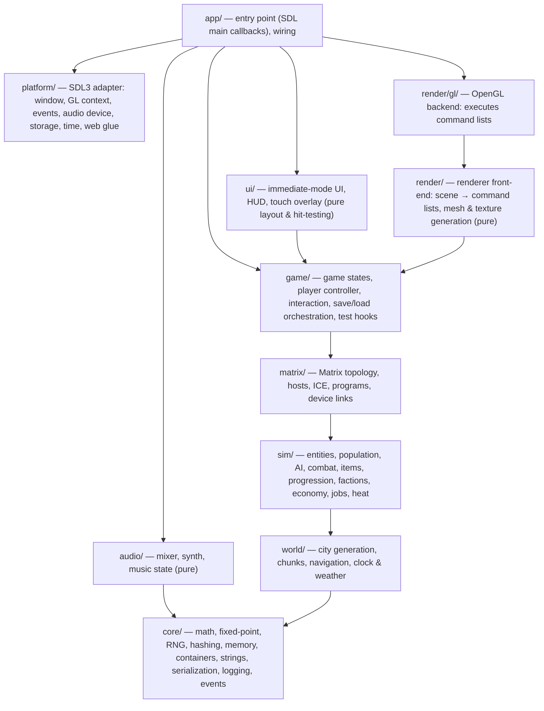
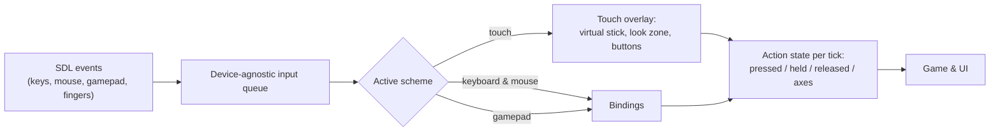
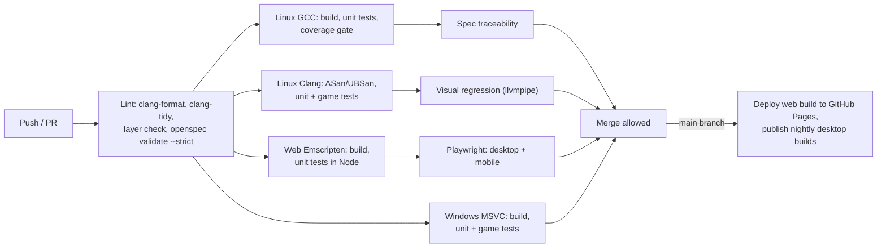

# Silverrock — Technical Design Concept

Status: Concept v0.1 — 2026-11-04 · Companion to the [game design](01-game-design.md) and the [roadmap](03-roadmap.md).

This document describes **how** Silverrock is built: architecture, determinism, rendering, platforms, and the
testing strategy that makes ≥ 95 % unit-test coverage and automated game tests realistic in C.

---

## 1. Goals and constraints

| Constraint | Consequence |
|---|---|
| C, SDL3, OpenGL | Plain C17, no C++ dependencies. SDL3 for windowing, input, audio, threads and storage. OpenGL 3.3 Core on desktop, OpenGL ES 3.0 (WebGL 2) on the web. |
| Windows, Linux, Web (Emscripten) | One codebase, one main-loop model, a shader subset valid on GL 3.3 and GLES 3.0, no threads required on the web. |
| Mobile browsers with touch | Touch input scheme, safe areas, lifecycle (backgrounding), memory and GPU budgets for phones. |
| Huge procedural, living city | Seeded deterministic generation, chunk streaming, level-of-detail simulation, time-sliced work. |
| ≥ 95 % unit-test coverage | "Functional core, imperative shell": almost all code is pure, headless and deterministic. SDL and GL code is thin and isolated, and tested against dummy and software drivers. |
| Automated game tests | Headless game runner, scenario scripts, autoplayer bots, input replays, visual regression, browser end-to-end tests. |
| OpenSpec | Every behaviour lives in a spec scenario. Every scenario maps to at least one automated test. |

## 2. Technology stack

| Area | Choice | Notes |
|---|---|---|
| Language | **C17** | Builds with GCC ≥ 12, Clang ≥ 15, MSVC 2022 (`/std:c17`), Emscripten. No compiler extensions required. |
| Platform layer | **SDL 3** (latest stable 3.x tag, pinned) | Window, GL context, events, gamepad, touch, audio streams, threads, storage. The main-callbacks entry point is used on every platform. |
| Graphics | **OpenGL 3.3 Core** / **OpenGL ES 3.0** (WebGL 2) | Shared GLSL source with an injected version preamble. Instancing, MRT, texture arrays and UBOs exist in both. |
| GL loader | glad 2 (generated, vendored) | Desktop only; the web uses Emscripten's GLES3 headers. |
| Decoders | stb_image, stb_image_write, stb_vorbis (vendored) | Public domain, single-file. `stb_image_write` is used by tests and screenshots. |
| Unit tests | **Unity** (ThrowTheSwitch, vendored) | Pure C; runs natively and as WebAssembly under Node. |
| Coverage | gcov / llvm-cov + **gcovr** | HTML and Cobertura reports, `--fail-under-line` gate. |
| Build | **CMake ≥ 3.25** + `CMakePresets.json` | Ninja, Visual Studio and `emcmake`. Dependencies pinned via git submodules or `FetchContent` with fixed hashes. |
| Web toolchain | **Emscripten** (pinned emsdk version) | WebGL 2 only, no pthreads. |
| Browser tests | Playwright (Node) | Desktop browsers plus mobile emulation with touch. |
| Spec tooling | OpenSpec CLI (pinned) | `openspec validate --all --strict` in CI. |
| CI tooling | Python 3 scripts | Spec traceability, coverage-exclusion budget, layer check, image-diff reports. |

Third-party code lives in `third_party/` and is excluded from coverage and warnings-as-errors.

## 3. Architecture

### 3.1 Layers



**Dependency rule:** a module may only include headers from layers below it. Only `platform/`, `render/gl/` and
`app/` may include SDL or OpenGL headers. A CI script checks every `#include` against this graph.

Everything from `core/` up to `game/`, plus the render front-end, UI and audio mixer, is **pure C**: no SDL, no
GL, no file system, no wall clock. These modules are deterministic and run unchanged in unit tests, the headless
game runner, and the shipping game.

### 3.2 Source layout

```
silverrock/
├── CMakeLists.txt, CMakePresets.json
├── src/
│   ├── core/  world/  sim/  matrix/  game/
│   ├── render/  render/gl/  ui/  audio/
│   ├── platform/            # sdl_*.c (all targets), web_*.c (Emscripten-only), win32_*.c (Windows-only)
│   └── app/main.c
├── shaders/                 # GLSL shared by GL 3.3 and GLES 3.0
├── data/                    # text data tables, embedded into the binary at build time
├── web/                     # HTML shell, PWA manifest, service worker, CSS
├── tests/
│   ├── unit/                # Unity tests, mirroring src/
│   ├── game/                # scenario scripts (*.scn), replays, autoplayer configs
│   ├── render/              # golden images
│   ├── web/                 # Playwright tests
│   └── fuzz/                # libFuzzer targets and corpora
├── tools/                   # embed tool (C), spectrace.py, coverage_budget.py, layercheck.py, golden updater
├── third_party/             # SDL3, glad, stb, Unity (pinned)
├── docs/concept/            # this concept
└── openspec/                # specs and change proposals
```

## 4. Main loop and timing

- SDL3's **main callbacks** (`SDL_AppInit`, `SDL_AppEvent`, `SDL_AppIterate`, `SDL_AppQuit`) are used on all
  platforms. On the web, SDL drives them from `requestAnimationFrame`, so there is no special web loop.
- **Fixed timestep:** the simulation advances in fixed 1/60 s steps from an accumulator. At most 5 steps run per
  frame (the remainder is dropped), which prevents a "spiral of death" after a long frame. Rendering interpolates
  between the last two states.
- **Tick rates by system:**

| System | Rate |
|---|---|
| Player, physics, combat, near NPCs, Matrix persona | every step (60 Hz) |
| Mid-tier NPCs | 10 Hz, staggered across steps |
| Far-tier population, economy | on in-game minute and hour boundaries |
| Faction strategy | every 6 in-game hours |
| World generation tasks | time-sliced, with a per-frame budget (e.g. 4 ms desktop, 2 ms mobile) |

- **Threads.** On desktop a small worker pool (SDL threads) runs chunk generation, navigation building and path
  batches. On the web everything runs time-sliced on the main thread. Avoiding pthreads means no
  `SharedArrayBuffer`, so no COOP/COEP headers are needed and the game runs on any static host, including iOS
  Safari. Tasks are pure functions of their inputs and results are merged in request order, so the outcome never
  depends on the thread count.

## 5. Determinism and randomness

- **RNG:** PCG32. There is no global generator. Each system derives named streams with
  `stream = hash64(seed, domain_tag, ids...)` (for example `("chunk", x, y)` or `("npc", id)`). Adding a new
  random call in one system never shifts another system's results.
- **World generation is bit-exact across platforms.** It uses integer and Q16.16 fixed-point math only. There is no
  `libm` in generation code; trigonometry and square roots use our own fixed-point routines. Golden digests of
  generated cities are compared between Linux, Windows and Web in CI.
- **Simulation** may use floats. It is reproducible on the same binary and platform, which is enough for replays.
  It builds with `-ffp-contract=off`, never with `-ffast-math`, and with `/fp:precise` on MSVC. The simulation
  never reads the wall clock and never iterates in pointer or hash order.
- **State checksums:** a function hashes the complete simulation state. Replays and save/load tests compare
  checksums.
- **Seed codes:** seeds are shown as human-friendly codes (e.g. `VESPER-7Q4K-2NMA`) that encode the 64-bit seed and
  a checksum. The generator version is stored with every save.

## 6. World generation

### 6.1 Two phases

1. **Macro phase** (once per new game, target ≤ 3 s on desktop, ≤ 6 s on a mid-range phone, with a progress bar):
   geography, districts, roads, metro, blocks, lots, building footprints and heights, places of interest, factions,
   notable citizens and the Matrix topology. Stored in compact arrays (target ≤ 32 MB).
2. **Detail phase** (on demand, per 64 × 64 m chunk): building meshes, facade modules, props, signage, navigation
   data. Interiors are generated when the player approaches an entrance. Chunks live in an LRU cache (for example
   300 chunk meshes on desktop, 120 on mobile).

### 6.2 Streaming and horizon

The streaming radius follows the fog distance (about 400 m on desktop, 250 m on mobile). Beyond it, a skyline
impostor — a low-poly silhouette ring with lit windows, built in the macro phase — closes the horizon. Landmark
holo-logos are drawn beyond the fog.

### 6.3 Deltas

Everything the player or the simulation changes (opened doors, looted containers, destroyed objects, dead NPCs,
changed ownership) is stored as a delta keyed by stable IDs and applied after a chunk is regenerated. Saves contain
the seed plus the deltas, not the city.

### 6.4 Validation

Generators assert invariants (connectivity, required districts, required places of interest near the player's home,
at least two routes into mission sites, no overlapping buildings). A failure re-rolls the affected stage with a
derived sub-seed. Property tests run these invariants over thousands of seeds (§12).

### 6.5 Navigation

Each chunk has a navigation graph (sidewalks, crossings, stairs, skyways, interiors as portal graphs). Paths are
found with hierarchical A* (chunk graph, then local graph). Crowds near the player use local steering with
avoidance.

## 7. Simulation

- **Entities:** 32-bit generational handles. Components are stored in dense arrays. Systems are plain functions over
  component sets. No virtual dispatch.
- **Notable citizens** are compact records while far away. In mid or near range they become entities, and when they
  leave they go back to records with their updated state.
- **AI:** utility AI for citizens (needs and schedules); a finite-state machine for alert and combat behaviour
  (unaware → suspicious → searching → combat). Vision samples a light grid, so darkness matters; hearing propagates
  sound events along navigation distance.
- **Factions:** data-driven goal and operation templates. Each operation has its own RNG stream, so resolution is
  deterministic.
- **Economy:** price indices per district and goods category, with modifiers from world events.
- **Event bus:** typed world events (crime, death, operation outcome, data leak, election result) feed consumers
  such as news, rumours, Heat, standing and prices.

## 8. Rendering

### 8.1 Front-end and backend

The front-end turns the visible scene into **command lists** (mesh, material, transform, light indices, render
state). It is pure C and unit-tested. The OpenGL backend executes the lists. A null backend is used in headless runs.

### 8.2 Portability

GLSL is written once. The loader prepends `#version 330 core` on desktop, or `#version 300 es` plus precision
qualifiers on the web. Features missing from GLES 3.0 are avoided: no geometry shaders, no `glPolygonMode`
(Matrix wireframes use barycentric coordinates), no texture buffers. The renderer handles WebGL context loss by
rebuilding GPU resources from CPU-side data.

### 8.3 Retro pipeline

1. **Scene pass** into a low-resolution framebuffer (default 480 × 270) with colour, emissive (second render target)
   and depth. Per-vertex lighting, district-tinted exponential fog, optional vertex snapping and affine texture
   mapping.
2. **Bloom** from the emissive target, at quarter resolution.
3. **Composite:** bloom, ordered dithering, colour quantisation, optional CRT and VHS effects.
4. **Upscale** with nearest-neighbour filtering to the window, letterboxed, with optional integer scaling.
5. **UI pass** at a separate integer-scaled UI resolution, so text stays readable on phones.

### 8.4 Lights, batching, characters

- Up to 8 lights per draw call, chosen on the CPU from a light grid by influence. Neon, windows, vehicles and muzzle
  flashes are all lights.
- Static chunk geometry is merged per chunk and material. Textures live in `GL_TEXTURE_2D_ARRAY` atlases (no
  bleeding, available in WebGL 2). Crowds and props use instancing.
- Characters are rigid-part models with CPU-side hierarchical animation and per-instance palette and texture
  indices. No skinning is needed.
- Culling: chunk frustum culling, the fog distance, and portal cells for interiors.
- Dynamic internal resolution kicks in when the frame time exceeds budget (mainly on mobile).

### 8.5 Procedural textures

A texture generator produces bricks, panels, window grids, signage (bitmap-font text on generated shop names),
faces and graffiti. It is deterministic and checked with golden images. This keeps the web download small: the
target is ≤ 20 MB compressed for the initial load.

## 9. Audio

An SDL audio stream at 48 kHz stereo is fed by a pure-C software mixer (voices, 3D attenuation and panning, buses,
ducking), a small synthesiser for UI and Matrix sounds, and `stb_vorbis` for music and samples. Mixer and synth are
unit-tested on sample buffers. On the web, audio starts after the first user gesture.

## 10. Input and touch



- The game only reads **actions** (MoveX, MoveY, LookX, LookY, Fire, Aim, Jump, Crouch, Sprint, Interact, Reload,
  Gadget, Quick1–4, Inventory, Map, JackIn, Netsight, Pause).
- **Scheme detection:** on the web, `matchMedia('(pointer: coarse)')` picks the initial scheme. After that, the last
  device used wins: a finger event activates touch, and mouse or keyboard input switches back.
- **Touch overlay:** layout in normalised coordinates plus safe-area insets (read from CSS `env(safe-area-inset-*)`
  and passed to C). Hit-testing, the floating stick and multi-touch tracking are pure and unit-tested.
- **Desktop web:** pointer lock on click (relative mouse mode).
- **Mobile web:** fullscreen and `screen.orientation.lock('landscape')` on the first tap where supported, a rotate
  prompt otherwise (for example iOS Safari), `touch-action: none` to block browser gestures, and a pause plus
  autosave on `visibilitychange`.

## 11. Persistence

- **Settings:** a small key-value text file in user storage.
- **Saves:** a little-endian binary format with the magic `SRSV`, a format version, the generator version, and
  sections (type, length, payload, CRC32). Contents: seed and city options, world deltas, faction state, notable
  citizens, economy, player, jobs and arcs, RNG stream states, and the clock.
- **Atomic writes:** write `slot.tmp`, flush, then rename. A crash never corrupts the previous save.
- **Storage paths:** desktop uses SDL's per-user storage location. The web mounts IDBFS (IndexedDB) and syncs after
  every save and before loading, so saves survive reloads and browser restarts.
- **Versioning:** each section has its own version and migration chain. Saves from a newer version are refused
  with a clear message. The loader is fuzzed.

## 12. Testing strategy and quality gates

### 12.1 Test pyramid

| Level | What | Where it runs | Gate |
|---|---|---|---|
| **Unit** | every module, Unity framework | Linux, Windows, Web (Node) | all pass; **≥ 95 % line coverage** (Linux) |
| **Property / invariant** | world generation and simulation invariants over many seeds | Linux | all pass (50 seeds per PR, 2,000 nightly) |
| **Golden** | city digests per seed (identical across platforms), textures, name generators | all | exact match |
| **Game (headless)** | scenario scripts and autoplayer bots on the real game loop | Linux, Windows | all pass |
| **Replay** | recorded input with periodic state checksums | Linux, Windows | identical checksums |
| **Visual regression** | fixed seeds and camera paths, software GL (Mesa llvmpipe) | Linux | within tolerance |
| **Browser end-to-end** | Playwright on desktop and mobile emulation | Linux | all pass |
| **Fuzz** | save loader, data parser, scenario parser, seed codes | Linux nightly | no crashes |
| **Sanitizers** | ASan, UBSan, LSan on unit and game tests | Linux (Clang) | zero findings |
| **Performance** | worldgen time, simulation tick at peak load | Linux | below thresholds |

### 12.2 Reaching 95 % honestly

- The **gate is measured on the unit-test suite alone** (game tests add coverage on top, but don't count towards
  the gate). Scope: all first-party code in `src/`. Third-party code is excluded.
- Pure modules — about 90 % of the code — are tested directly.
- `render/gl/` unit tests run against a real OpenGL 3.3 context created through SDL's offscreen video driver with
  Mesa llvmpipe. They render into framebuffers and read pixels back.
- `platform/` unit tests use SDL's dummy and offscreen drivers and inject events with `SDL_PushEvent`.
- Allocators accept fault injection, so out-of-memory paths are tested too.
- **Exclusions** are allowed only for code that cannot run on Linux (Win32-only and Emscripten-only files) and for
  `SR_UNREACHABLE` paths. Each exclusion needs a written reason. A script fails the build if exclusions exceed 1.5 %
  of first-party lines. Platform-specific code is verified by the Windows and browser test jobs instead.
- Per-directory minimum of 90 %, so a well-tested module can't hide an untested one. Branch coverage is reported
  from day one; a branch gate of 85 % is planned from milestone M2.

### 12.3 Headless game runner and scenario scripts

The game binary has a headless mode: null renderer, null audio, no window, simulation at maximum speed. Scenario
scripts drive it with high-level commands and synthetic input, and assert on game state through the test-hook
query interface:

```text
# tests/game/rent_eviction.scn
# @spec player-life: Two missed payments lead to eviction
seed        VESPER-7Q4K-2NMA
newgame     background=street_kid
expect      player.home != none
set         player.cash = 0
advance     8d
expect      player.rent.missed == 1
advance     7d
expect      player.home.locked == true
expect      player.home.stash.count > 0     # nothing is destroyed
```

```text
# tests/game/first_month.scn
# @spec job-system: Starter economy is sustainable
seed        random(50)                      # run on 50 seeds
newgame     background=any
autoplay    strategy=gig_worker weeks=4     # bot plays through the action layer
expect      player.rent.missed == 0
expect      player.needs.starving_hours == 0
```

- **Autoplayer bots** play through the same action layer as a human — no teleporting or cheating. They use goal
  planners for strategies such as "gig worker", "ghost", "netrunner" and "hammer". They catch soft-locks, broken
  job generation and economy imbalance across many seeds.
- **Test hooks** (`SR_TEST_HOOKS`, never compiled into release builds) expose a command and query interface. On
  the web, the same interface is an exported function that Playwright calls.

### 12.4 Visual regression

Fixed seeds, times, weather and camera paths are rendered with the real GL backend on llvmpipe and compared with
golden PNGs (per-channel tolerance plus a cap on the share of differing pixels). Diffs are uploaded as CI artefacts.
Goldens are only updated with a dedicated tool and a reviewed commit.

### 12.5 Browser end-to-end

Playwright runs Chromium, Firefox and WebKit on desktop, and emulated mobile devices with `hasTouch`. Tests include:
the game boots with no console errors; a new game starts; the touch overlay is visible on mobile and hidden on
desktop; dragging the virtual stick moves the player (checked through the test hook); a desktop click requests
pointer lock; save, reload, load works; a hidden page pauses the game.

### 12.6 Spec traceability

Each test that verifies a spec scenario carries a tag: `SR_SPEC("capability", "Scenario name")` in C (a macro that
compiles to nothing) or `# @spec capability: Scenario name` in scenario scripts and Playwright tests.
`tools/spectrace.py` collects every `#### Scenario:` from `openspec/specs/` and the active changes and matches them
with the tags:

- For main specs (implemented behaviour), CI **fails** if a scenario has no test.
- For in-flight changes, it reports progress only.
- Scenarios that can only be verified by hand (for example "feels responsive on a reference phone") are listed in
  `tests/manual-verification.md` with a reason.

### 12.7 CI pipeline



The **nightly** job adds the 2,000-seed sweep, fuzzing, a 52-week faction-simulation soak under sanitizers, and an
autoplayer balance report (earnings curves per strategy).

## 13. Content and data

- Data tables are text files in `data/` (a small INI-like format with a tested and fuzzed parser): weapon
  archetypes, manufacturer styles, gadgets, cyberware, job templates, arc templates, operation templates, naming
  morphemes, the real-name blocklist, district styles, palettes, dialogue templates and localisation strings.
- A build tool written in C embeds the tables into the binary, so there is no runtime file loading on any platform.
  Debug desktop builds can hot-reload them.
- Dialogue uses templates with variables and conditions. English first; all strings go through string tables.

## 14. Platform notes

| Platform | Build | Ships as | Notes |
|---|---|---|---|
| **Windows x64** | MSVC 2022, `/std:c17 /W4 /WX`, static CRT | zip with exe | optional MinGW job for extra GCC diagnostics |
| **Linux x64** | GCC and Clang, SDL3 built from source and linked statically | tarball, later AppImage | X11 and Wayland through SDL |
| **Web** | Emscripten, WebGL 2 only, `ALLOW_MEMORY_GROWTH`, no pthreads, `-O3 -flto` | static site (HTML, JS, Wasm) with PWA manifest and service worker | hosted on GitHub Pages; "Add to home screen" runs fullscreen in landscape |

macOS is not a target, but SDL3 and GL 3.3 Core keep the door open.

## 15. Performance budgets

| Metric | Desktop reference (integrated GPU, Iris Xe class) | Mobile web reference (2023 mid-range phone) |
|---|---|---|
| Frame rate | 60 FPS at 1080p output | ≥ 30 FPS (P95) |
| Draw calls per frame | ≤ 400 | ≤ 250 |
| Triangles per frame | ≤ 250 k | ≤ 120 k |
| Visible agents at peak | 150–250 | 60–100 |
| Memory | ≤ 512 MB | ≤ 300 MB Wasm heap |
| New city (macro phase) | ≤ 3 s | ≤ 6 s |
| Initial download | — | ≤ 20 MB compressed |
| Time to main menu | ≤ 3 s | ≤ 10 s on broadband |

## 16. Coding conventions

- C17; CI builds with `-Wall -Wextra -Wpedantic -Wshadow -Werror` (MSVC `/W4 /WX`). Formatting with clang-format;
  static checks with clang-tidy.
- Naming: functions `sr_module_verb_noun()` (e.g. `sr_city_generate`, `sr_rng_next_u32`), types `SrPascalCase`,
  macros and constants `SR_UPPER_CASE`. Never use the `_t` suffix (reserved by POSIX).
- No mutable global state outside `platform/` and `app/`. Context structs are passed explicitly.
- Memory: arenas by lifetime (frame, chunk, level, persistent) and pools for entities. No `malloc` in per-frame
  paths. All allocation goes through allocator interfaces, which allows fault injection in tests.
- Errors: functions return `SrResult` codes. `SR_ASSERT` for programmer errors (debug builds), `SR_UNREACHABLE` for
  impossible states. No `setjmp`/`longjmp`.
- One module = one public header plus its `.c` files. Public functions get a short doc comment.

## 17. Spec-driven workflow with OpenSpec

- `openspec/config.yaml` holds project context and rules for proposals, specs, designs and tasks.
- Work is organised as **changes** in `openspec/changes/<change-id>/`: proposal, design, tasks and spec deltas. The
  roadmap maps milestones to changes.
- A change is implemented task by task. Every task lands with its tests. When all tasks are done and CI is green,
  `openspec archive <change-id>` merges the change's spec deltas into `openspec/specs/`. From then on, the
  traceability gate enforces a test for every scenario of those specs.
- CI runs `openspec validate --all --strict` on every push.
