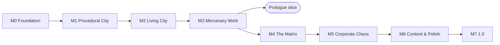

# Silverrock — Roadmap, Risks and Open Questions

Status: Concept v0.1 — 2026-11-04 · Companion to the [game design](01-game-design.md) and the
[technical design](02-technical-design.md).

## 1. Milestones

Each milestone ends with something playable on **all three targets** (Windows, Linux, Web including mobile touch)
and with every quality gate green. Each milestone is one OpenSpec change in [`openspec/changes/`](../../openspec/changes).

| # | Milestone | OpenSpec change | Delivers | Exit demo |
|---|---|---|---|---|
| **M0** | Foundation | `add-engine-foundation` | CMake presets for all targets, SDL3 + GL bootstrap, core library, input actions with keyboard/mouse, gamepad and touch, headless runner, scenario scripts, coverage and traceability gates, CI on three platforms | A grey-box room you can walk around in on Windows, Linux, desktop browsers and a phone (touch) |
| **M1** | Procedural City | `add-procedural-city` | Seeded city generation, faction roster, world clock and weather, retro renderer, chunk streaming, metro, player apartment | Wake up in your apartment and walk across a generated city at night, in the rain |
| **M2** | Living City | `add-living-city` | Population with routines and LOD simulation, services and shops, needs, money, rent and housing, save system | Survive a week: eat, sleep, shop, ride the metro, pay rent; crowds commute and react |
| **M3** | Mercenary Work | `add-mercenary-work` | Jobs T0–T2, combat, stealth, enemy AI, weapons, gadgets, cyberware, progression, Heat | Take gigs and runs, solve them in different ways, level up, get chased by the police |
| **M4** | The Matrix | `add-matrix` | Global grid, hosts, ICE, programs, breaching, real-world device links, Netsight quick-actions | Prepare a run in the Matrix, then execute it in meatspace with looped cameras and opened doors |
| **M5** | Corporate Chess | `add-corporate-chess` | Faction simulation, politics, gangs, markets, news, patron and handler, procedural arcs, story acts, endings | The full campaign, from rent-is-due to an ending |
| **M6** | Content & Polish | *(future changes)* | More archetypes and arcs, audio, accessibility, localisation, mobile performance, PWA polish, balancing with bot reports | Release candidate |
| **M7** | 1.0 | — | Launch | — |

### Status (2026-11-06)

M0–M4 are implemented. Open items are the manual checks on Windows hardware and real phones (one exit demo per
milestone) and M5. Unit, platform, scenario, browser and gate tests all pass in CI; line coverage is 98.6 %. The
web build is deployed to GitHub Pages from the default branch.

## 2. First playable slice

The first externally playable build is the **Prologue slice** after M3, with a minimal M4:

- one city size, 5–7 megacorps, 8–10 districts;
- T0–T2 jobs, 10 weapon archetypes, 6 gadgets, 6 cyberware items;
- a Matrix with three host types (shop, clinic, warehouse) and three ICE types;
- the prologue: rent, food, the first fixer, the secret test, the patron's first contact.

It answers the riskiest questions early: is the city readable and alive, is the rent loop fun, do touch controls
work, and does the web build perform on phones?

## 3. Out of scope for 1.0

Player driving · multiplayer · full voice acting · user mods · macOS and native mobile apps (possible later thanks
to SDL3).

## 4. Risk register

| Risk | Impact | Likelihood | Mitigation |
|---|---|---|---|
| **Scope.** A living procedural city with an RPG, a Matrix and a faction simulation is very large. | High | High | Systemic design instead of handmade content; a playable exit demo per milestone; an explicit out-of-scope list; the Prologue slice as an early reality check. |
| **Samey or unreadable cities.** Procedural output looks like noise. | High | Medium | District palettes, landmark rules, curated facade module libraries, readability invariants (signage, landmarks, palettes) and art reviews of screenshots from many seeds at every milestone. |
| **Incoherent emergent story.** The faction simulation produces nonsense. | High | Medium | Authored story spine, arc templates, bounded simulation, story-progression bots, narrative review of generated arcs. |
| **Mobile web performance.** | High | High | Budgets from day one; the M0 grey box is tested on a real phone; LOD, dynamic resolution, a mobile quality preset; no pthreads. |
| **Touch controls feel bad in a first-person shooter.** | Medium | High | Aim assist, floating stick, playtests from M0, adjustable sensitivity and layout; a gyro aiming option later. |
| **95 % coverage slows development.** | Medium | Medium | Functional core and imperative shell; test helpers and fixtures; per-PR coverage feedback; software GL so the backend can be tested. |
| **Determinism bugs** break seeds, replays or saves. | Medium | Medium | Fixed-point world generation, cross-platform golden digests, state checksums and replay tests from M0. |
| **GL vs. WebGL differences and driver bugs.** | Medium | Medium | Strict shader subset, llvmpipe in CI, real-browser tests, context-loss handling. |
| **Save compatibility** across versions during development. | Medium | High | Sectioned, versioned save format with migrations; generator version stored in saves; incompatible saves clearly refused. |
| **iOS Safari quirks** (no orientation lock, audio unlock, memory limits). | Medium | High | Rotate prompt, audio unlock on gesture, ≤ 300 MB heap, WebKit in the Playwright matrix. |
| **Generated names collide with real brands or people.** | Low | Medium | Blocklist applied to every generator; review of name tables. |

## 5. Open questions

These are decisions for the project owner. The concept uses the default in **bold** until decided.

1. **Title.** Keep **Silverrock** (the repository name) as the working title?
2. **Patron selection.** **Random corp at new game** (selectable in advanced options), or let the player pick from
   two or three offers at the end of the prologue?
3. **Age rating and violence level.** Target **PEGI 16 / ESRB M** (non-graphic violence, no gore system)?
4. **Distribution.** For example a **free web version plus paid desktop builds** (itch.io / Steam). This affects
   save handling and PWA features.
5. **Languages.** **English at launch** with string tables ready, or also German from the start?
6. **Music and audio.** Commissioned, licensed (e.g. CC-BY), or **mostly procedural plus a few commissioned tracks**?
7. **Permadeath.** Keep the optional **Hardcore** mode?
8. **Team and timeline.** Team size and target date decide how much of M6 content makes it into 1.0.
