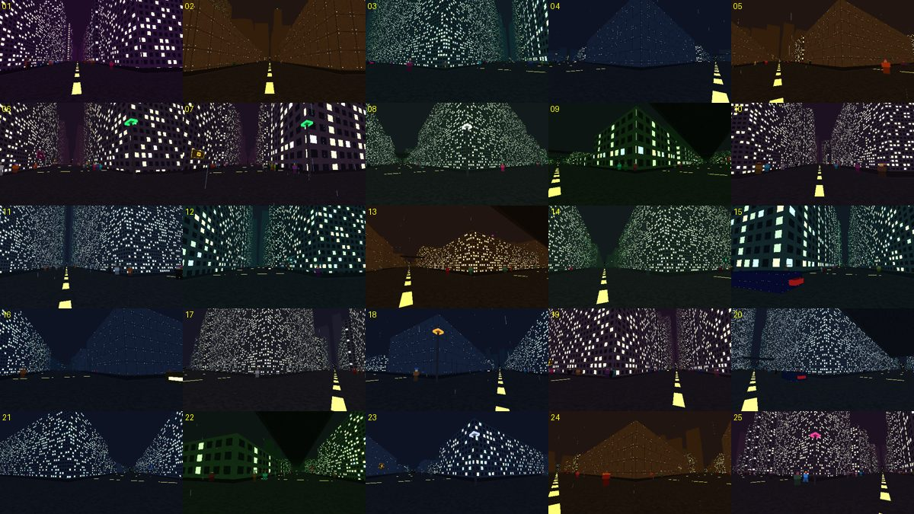
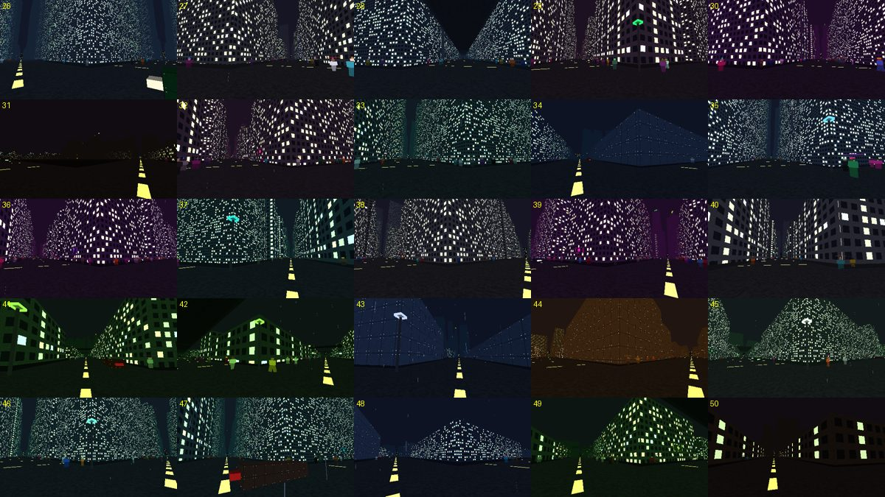

# M1 review: screenshots from 50 seeds

Task 11.2 of `add-procedural-city`. Reviewer: automated capture, reviewed by the implementer on 2026-11-05.

## How the screenshots were made

```bash
SR_SEED_SHOTS=out SR_RENDER_OUT=out xvfb-run -a ./build/linux-gcc-debug/sr_platform_tests test_seed_screenshots
```

For seeds 7919 × 1 … 7919 × 50 the test starts a game, stands at the street corner of one district's centre block
(the district index cycles with the seed), looks towards a megacorp HQ, sets Tuesday 22:00, lets the crowd fill in
for one second and saves the 480 × 270 internal frame. `m1-seeds-index.txt` lists district, district type, target
megacorp and the number of citizens around for each shot. All ten district types appear in the sample.

| Seeds 1–25 | Seeds 26–50 |
|---|---|
|  |  |

## Findings

| # | Finding | Severity | Action |
|---|---|---|---|
| 1 | Seeds 17–50 rendered as a flat colour on the first pass: every new game left its GPU meshes behind, and after about 16 games in one session the backend ran out of mesh slots and drew nothing. A player starting several new games in one session would have hit the same thing. | High | **Fixed.** The GL backend now reclaims slots of meshes that are no longer drawn (the slot remembers its owner mesh). New platform test `test_many_games_keep_rendering` starts 24 games in a row. |
| 2 | Barrens (seeds 31, 50) were nearly black: empty lots have no light source, only the far skyline was visible. | Medium | **Fixed.** Empty Barrens and Undercity lots get one or two burning barrels (emissive mesh plus a warm light in the light grid). Still the darkest district by design. |
| 3 | District palettes are distinct: purple Entertainment, amber Industrial, teal Residential, blue Docks, green Old Quarter and Campus, magenta Spire. No two adjacent district types were confused in the sample. | — | None. |
| 4 | Neon signage is readable at street level in most shots (business icons on 18 of 50 frames even with the camera aimed at an HQ, not at a shop). | — | None. |
| 5 | Landmarks: megacorp HQ logos are visible above the roofline only when the HQ lies down a street axis (6 of 50 frames); inside street canyons the nearest façades hide them. The HUD compass shows every HQ, so orientation does not depend on line of sight. | Low | Accepted for M1. Consider taller crowns or sky beacons for HQs in M6 content work. |
| 6 | Tall residential and Spire façades use very similar window grids; several frames look alike at a glance. | Low | Logged for M6 (more façade modules per district). |
| 7 | Crowds are present in every non-Barrens frame (65–400 citizens in range); traffic shows in Docks and Commercial frames. | — | None. |
