# Gameplay screenshots (after M5)

Rendered by the real app under Xvfb (Mesa llvmpipe, 1280×720) from seed `0x5EEDC0DE`, after ten
in-game days of the corporate game. To regenerate them:

```bash
SR_GAMEPLAY_SHOTS=out xvfb-run -a ./build/linux-gcc-debug/sr_platform_tests test_gameplay
```

| # | Shot | What it shows |
|---|---|---|
| 01 | 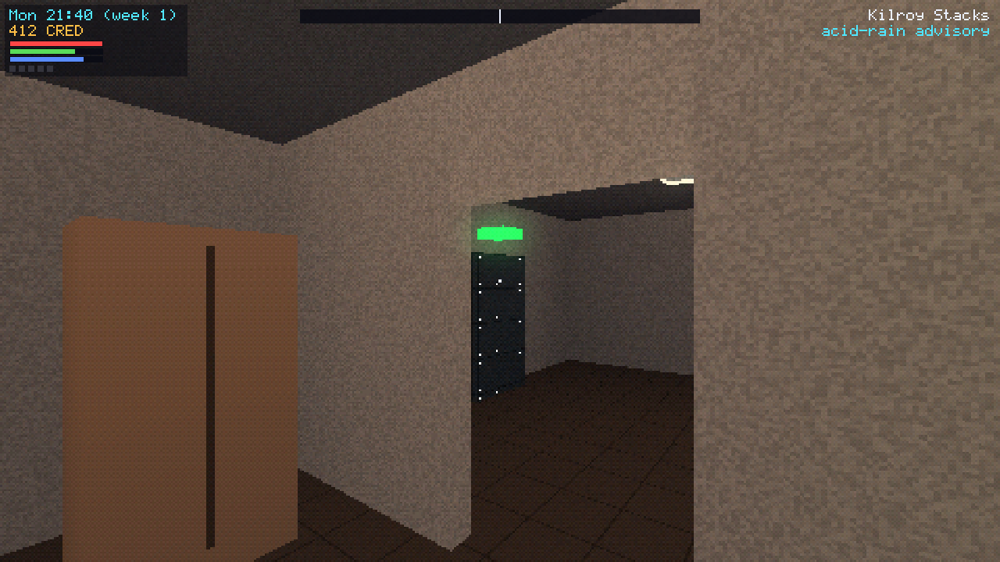 | Waking up in the apartment on Monday night |
| 02 | 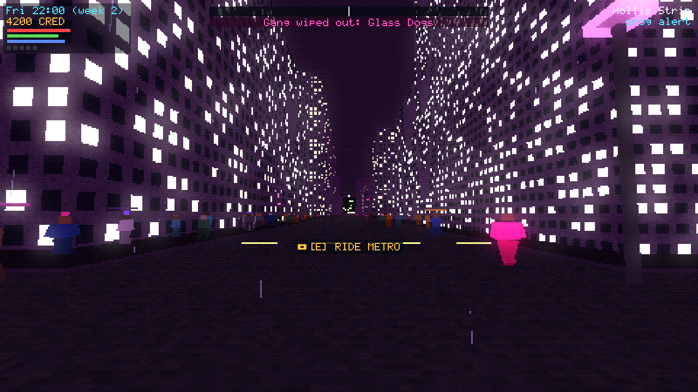 | The entertainment district at night: citizens, neon, the billboard ticker under the compass |
| 03 | 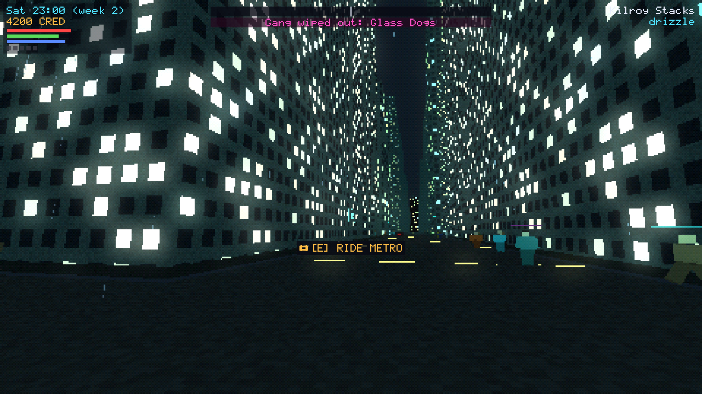 | The home district at 23:00 |
| 04 | 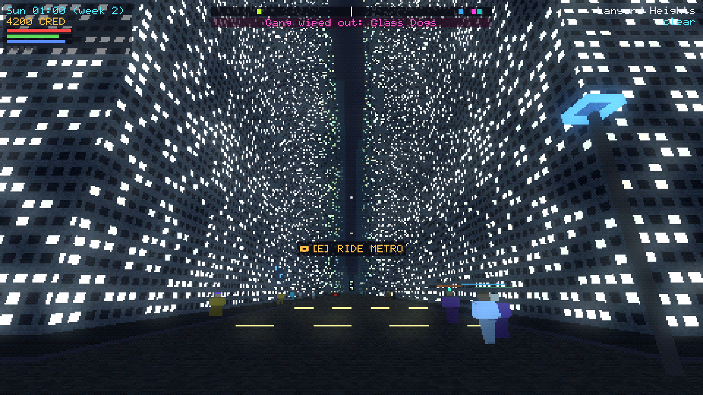 | Megacorp towers in the Spire |
| 05 | 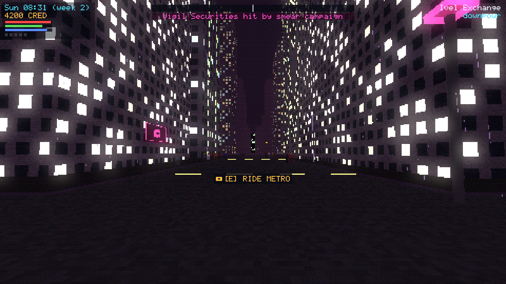 | Rain on a commercial street |
| 06 | 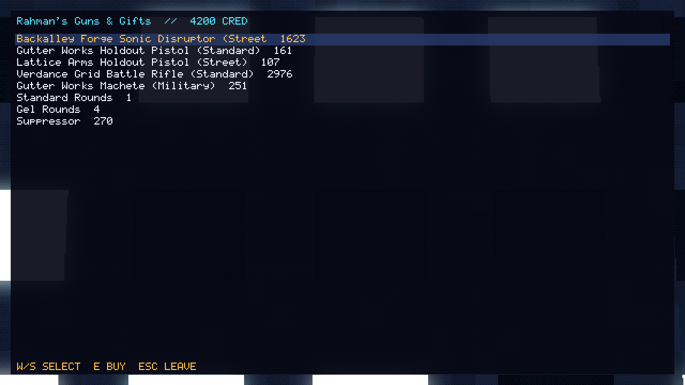 | Buying weapons in a gun shop |
| 07 | 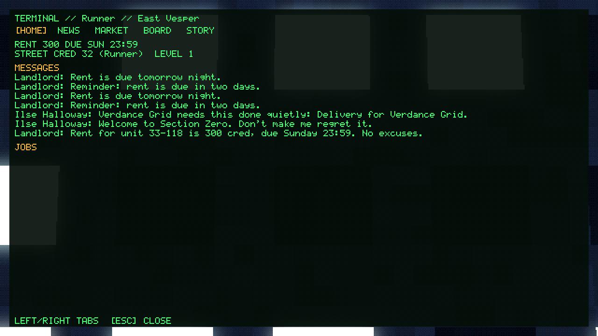 | Terminal: rent, Street Cred, messages from the landlord and the handler |
| 08 | 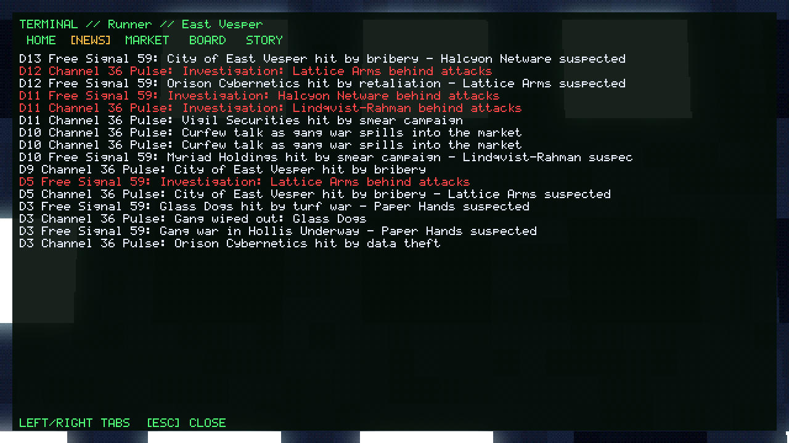 | Terminal news: outlets report attacks, bribes and gang wars; scandals in red |
| 09 | 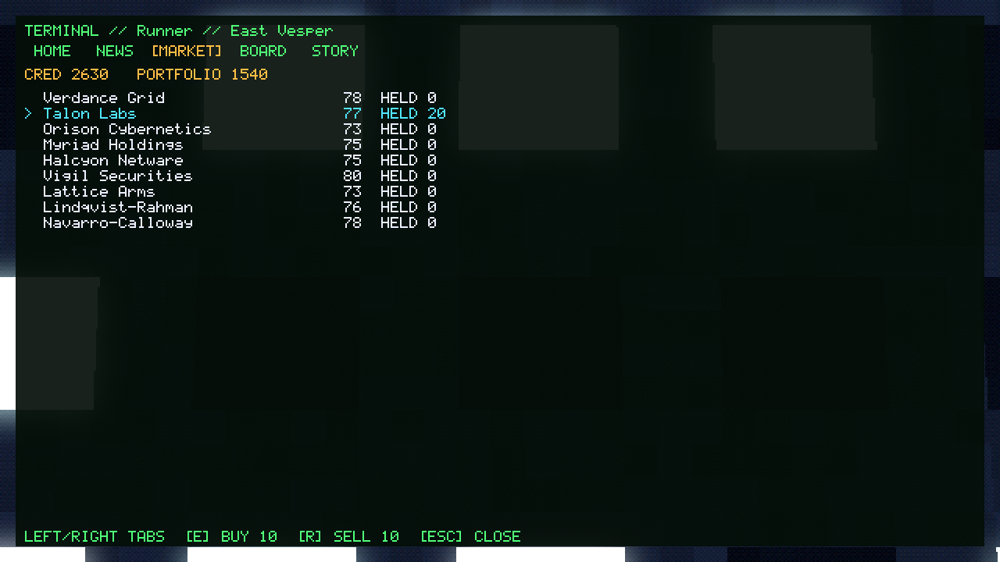 | Terminal market: share prices and the portfolio |
| 10 | 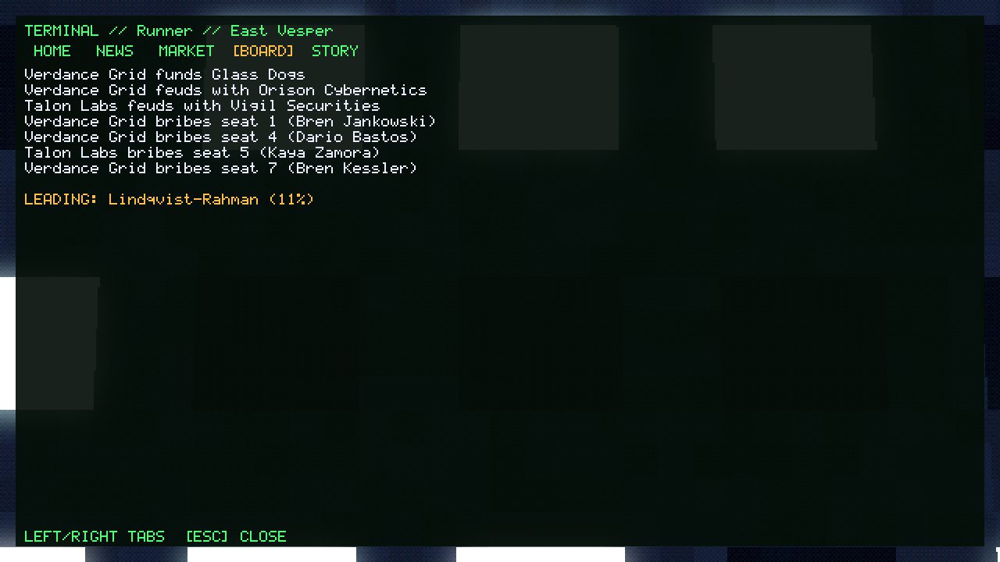 | The intel Board: who funds, feuds with and bribes whom |
| 11 | 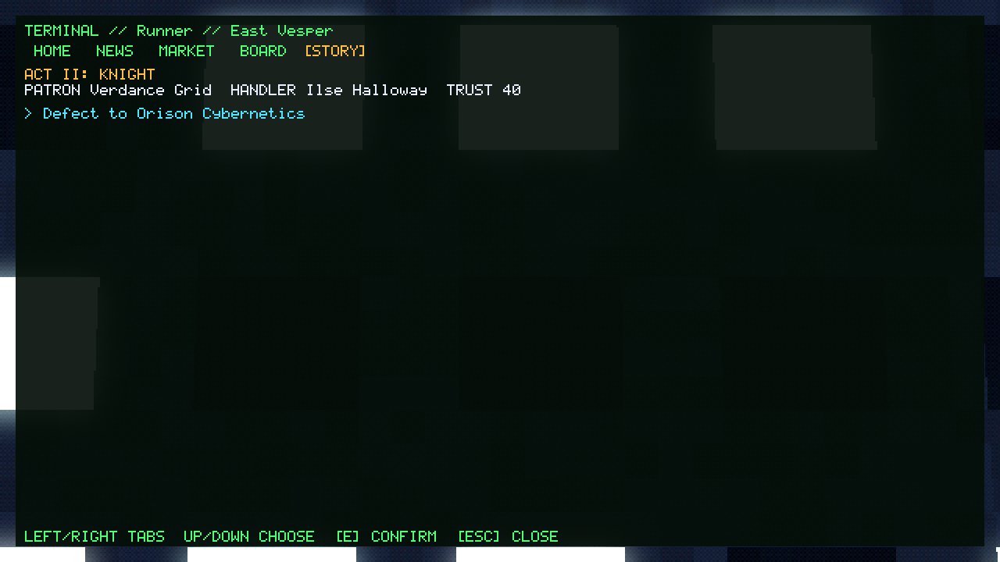 | Story tab in Act II: patron, handler, trust and a rival's offer to defect |
| 12 | 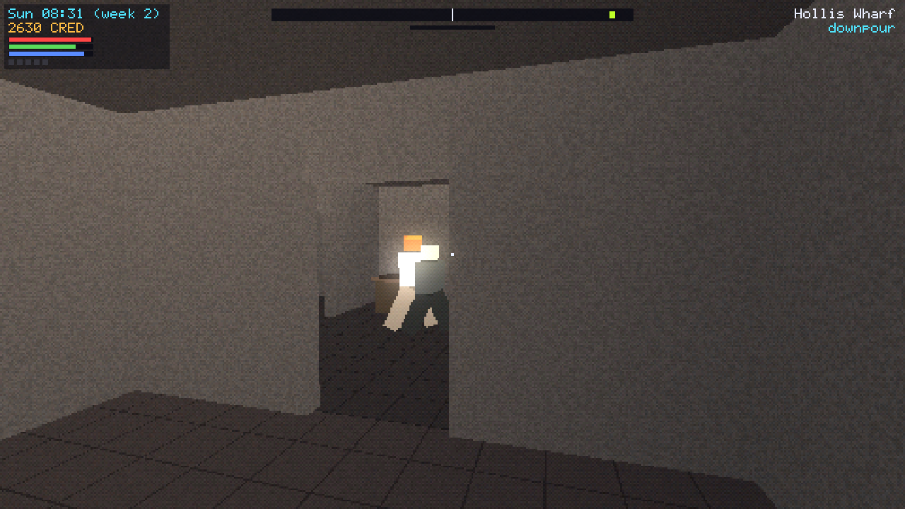 | Inside a mission site with a guard on patrol |
| 13 | 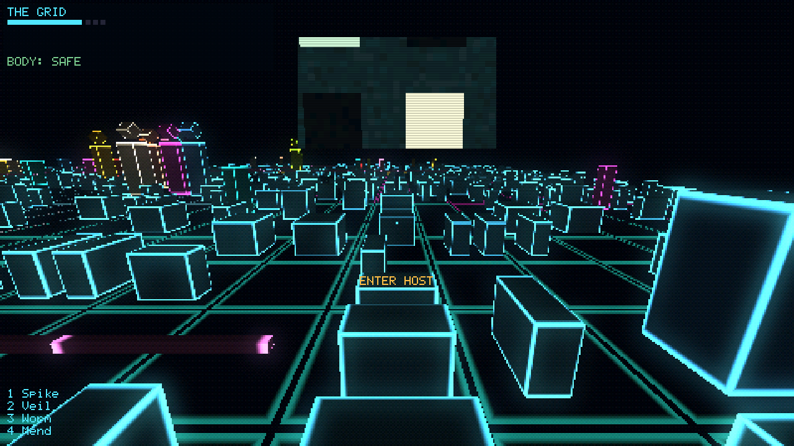 | The Matrix grid: the city at 1:40 in wireframe, with the meat-cam at the top |
| 14 | 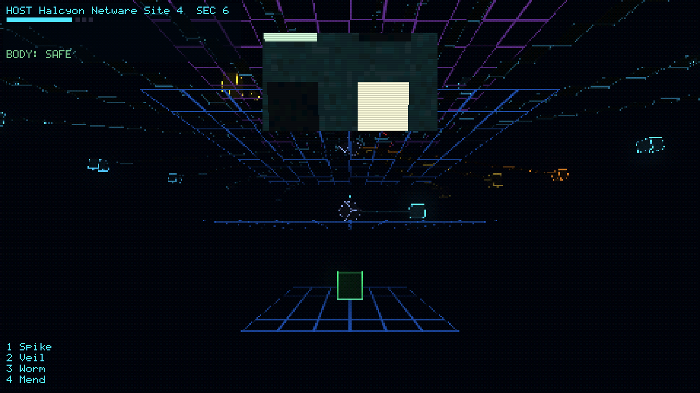 | A corporate host construct and its nodes |
| 15 | 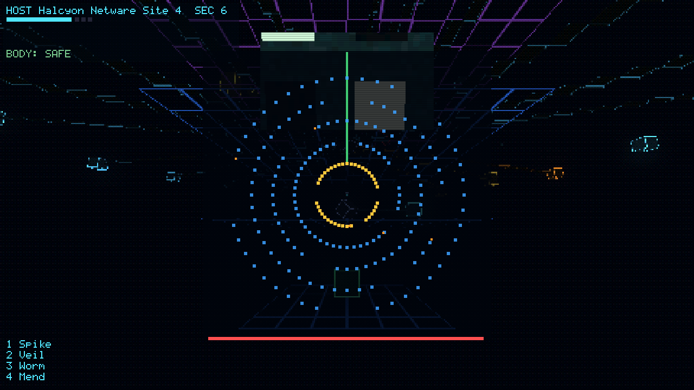 | Breaching a node: the ring puzzle |
| 16 | 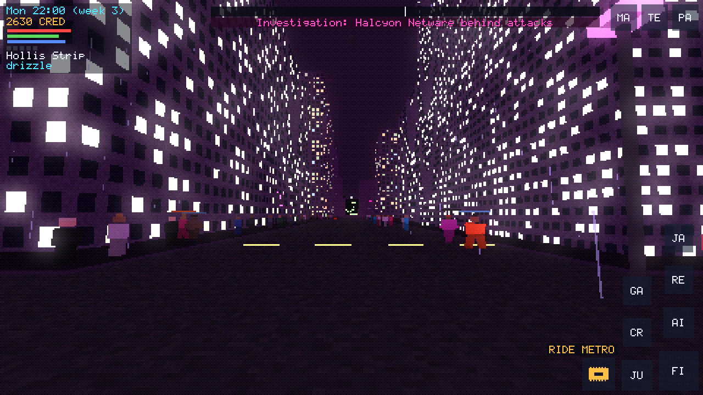 | Touch controls (phone layout) |
| 17 | 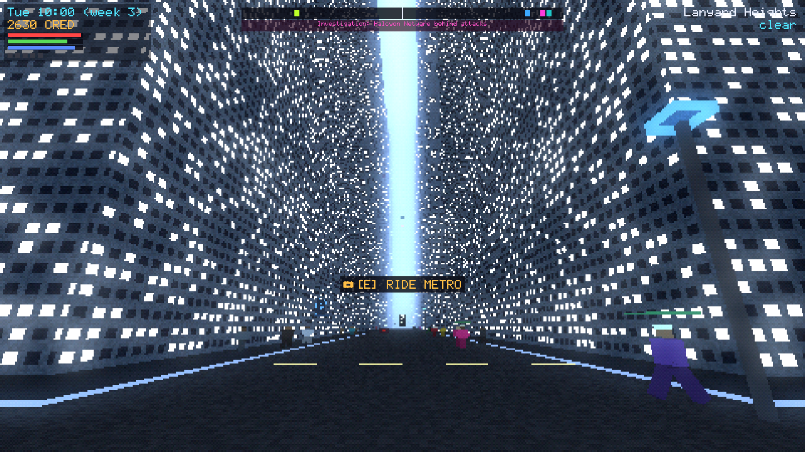 | The Sunrise ending: the only daylight in the game |
